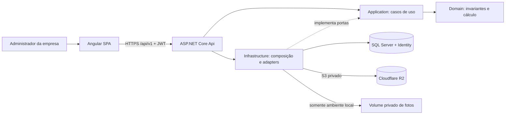
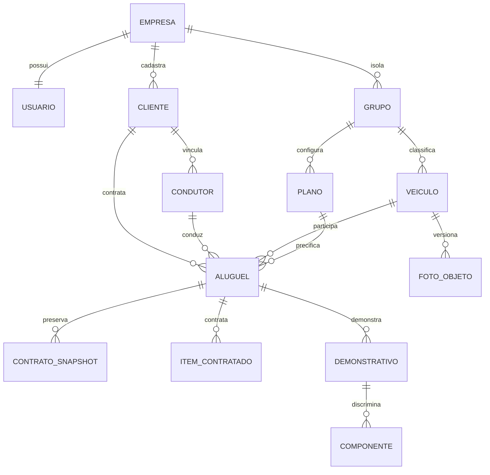
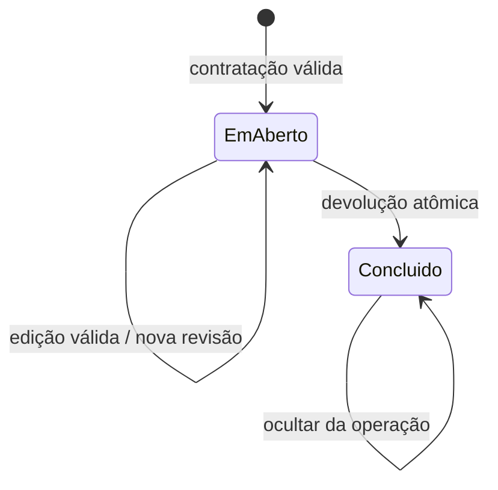

# TDD — Sistema Web para Gestão de Locadoras de Veículos

- **Status:** Rascunho técnico revisado; desenho validado pelo solicitante como base para futura SDD.
- **Data:** 2026-11-09.
- **Escopo:** desenho da v1 do PRD, sem implementação, instalações, provisionamento, commits ou PR.
- **Fonte de produto:** [docs/prd.md](prd.md), revisão datada de 2026-11-09, status `Validado para TDD` e handoff liberado na seção 12.2. RF-01–RF-19, RNF-01–RNF-07, RN-01–RN-09, J-01–J-05 e CA-01–CA-12 permanecem a referência.
- **Decisor conhecido:** solicitante, por meio da ferramenta `question`; responsáveis nominais de engenharia, segurança, produto e operação não designados.
- **Autoria:** documento elaborado pelo assistente com as decisões do solicitante. Não houve revisão técnica independente.
- **Governança:** consultados `AGENTS.md` e `openspec/config.yaml`. O PRD registra preparação anterior sem Git; nesta etapa foi constatado Git limpo na `main` e criada a branch `docs/tdd-locacao-veiculos`. A observação antiga não descreve o ambiente atual. Não foi alterado o PRD.
- **Autorização:** o solicitante confirmou arquitetura, dados, segurança, bibliotecas, tratamento privado de fotos e consolidação dos contratos e roadmap neste arquivo. Isso não autoriza implementação, produção ou aprovação automática da etapa SDD.

## 1. Resumo e objetivos técnicos

Construir uma SPA administrativa Angular e uma API .NET para operar empresas isoladas, frota, clientes, condutores, preços, contratação e devolução. O desenho prioriza isolamento entre empresas, consistência sob concorrência e demonstrativos históricos verificáveis, antes de otimizações de escala não demonstradas.

### 1.1 Restrições confirmadas

- Angular 22, Standalone, Zoneless e Signals; Tailwind CSS 4.
- .NET 10, solução `.slnx`, Clean Architecture, Entity Framework Core, SQL Server e ASP.NET Core Identity.
- Português, BRL, fuso `America/Sao_Paulo`, conta administrativa única por empresa.
- Código, testes e configurações da aplicação deverão ficar em `app/`; documentos e governança permanecem na raiz.
- Desenvolvimento local primeiro. R2 é o armazenamento remoto escolhido; local não exige conta nem credenciais Cloudflare.
- Todo o escopo obrigatório do PRD integra a v1. Incrementos intermediários não são uma v1 reduzida.

### 1.2 Limites

Não desenhar funcionários, múltiplas contas/perfis por empresa, reservas, cancelamento, reabertura, pagamentos, movimentação de caução, emissão fiscal, portal do cliente, manutenção ou integrações documentais/seguradoras. Recuperação de senha e administração da plataforma continuam fora dos fluxos v1; o procedimento operacional de recuperação é condição para produção, não funcionalidade implicitamente adicionada.

Não existem metas aprovadas de carga, latência, disponibilidade, cobertura percentual, RPO ou RTO. Não se afirma conformidade legal, autenticidade de documentos nem prontidão operacional.

## 2. Decisões técnicas centralizadas

Todas as decisões abaixo estão **confirmadas pelo solicitante**. Detalhes de contratos, índices e organização são o detalhamento autorizado do pacote técnico, não decisões de produto novas.

| ID | Tema e decisão | Origem, justificativa e alternativa | Consequências |
| --- | --- | --- | --- |
| DT-01 | Frontend Angular/CLI 22, TypeScript 6.0, Node 24 com mínimo 24.15.0, npm, RxJS 7; Standalone/Zoneless/Signals | Stack inicial e entrevista. Documentação oficial confirma os requisitos consultados; Angular 22.0.x exige TS >=6.0 e <6.1 | Fixar minor/patch compatíveis e lockfile na fase F0; não usar Zone.js |
| DT-02 | Tailwind 4 com `@tailwindcss/postcss`; componentes próprios acessíveis; formulários reativos tipados | Entrevista. Evita kit visual e dependência de estado global como NgRx | Equipe assume acessibilidade; ligar eventos de formulários a Signals/notificação de mudança |
| DT-03 | C# 14/.NET 10, ASP.NET Core com controllers REST; monólito modular Clean Architecture | Stack inicial e entrevista. Microserviços acrescentariam coordenação distribuída desnecessária | Domain/Application independentes de transporte e infraestrutura; uma unidade de deploy de API |
| DT-04 | EF Core 10, provider SQL Server 10, Identity EF Core 10; SQL Server 2022 Developer local | Entrevista. Banco compartilhado facilita transações e migrations | Developer não é licença de produção; edição/hospedagem futura a validar |
| DT-05 | Identity para credenciais; JWT próprio de acesso por 5 minutos; refresh opaco rotativo; sessão SQL revogável por 8h absolutas | Usuário preferiu JWT à recomendação inicial de cookie de sessão. Identity bearer nativo não é JWT | Validação de sessão em cada chamada reduz benefício stateless, mas atende logout imediato de CA-01 |
| DT-06 | Mesma origem; access token somente em memória; refresh em cookie HttpOnly/Secure/SameSite=Strict; antiforgery nos fluxos com cookie | Entrevista. Evita tokens persistidos em armazenamento acessível a scripts | XSS continua ameaça; renovação coordenada entre abas e CSP necessárias |
| DT-07 | Multitenancy por EmpresaId, filtros de leitura, guarda de escrita e FKs compostas | Entrevista. Banco/schema por empresa teria maior isolamento físico e custo operacional | SQL direto e consultas históricas exigem atenção; identificador recebido nunca determina empresa |
| DT-08 | Snapshots relacionais de contrato e demonstrativo, exclusão lógica, preços de combustível versionados por vigência | Entrevista. Referências vivas sozinhas não preservam RF-19/RNF-07 | Maior armazenamento e política de retenção a definir; devolução retroativa consulta preço vigente no instante informado |
| DT-09 | Dinheiro em `decimal`, transporte decimal em strings, UTC para instantes e fuso IANA explícito | Entrevista. Evita ponto flutuante e dias civis no cálculo de duração | Servidor calcula; navegador não é autoridade monetária |
| DT-10 | Transações SQL, bloqueio coordenado das mutações da empresa, índice único de aluguel aberto, rowversion/ETag e idempotência persistida | Entrevista. Índice sozinho não protege alterações simultâneas dos cadastros | Menor paralelismo por empresa; medir antes de reduzir granularidade dos bloqueios |
| DT-11 | Cloudflare R2 privado via AWSSDK.S3; SQL guarda URL da API, chave/bucket e metadados, nunca imagem | Escolha explícita do usuário, seguida da aprovação de proxy privado. Alternativa SQL binário foi rejeitada | Dependência externa de infraestrutura, sem tornar fotos públicas; não equivale a integração de negócio nova |
| DT-12 | JPEG/PNG, limite de 5 MiB e 16 megapixels; SkiaSharp decodifica/reencoda sem metadados; adaptador local privado | Entrevista posterior à escolha do R2. URLs assinadas públicas ao portador foram evitadas | Native assets/licenças/patches precisam de verificação; SQL e S3 não compartilham transação |
| DT-13 | DTOs, validação explícita e mapeamento manual; OpenAPI, `/api/v1`, ProblemDetails | Entrevista e autorização de detalhamento. Sem MediatR, AutoMapper ou FluentValidation inicialmente | Mais código explícito, menos dependências; invariantes continuam no domínio |
| DT-14 | xUnit, WebApplicationFactory, Testcontainers SQL Server, Vitest e Playwright | Entrevista. SQL real é necessário para verificar locks, índices e rowversion | SQLite/EF InMemory não comprovam concorrência nem isolamento SQL Server |
| DT-15 | Logs estruturados nativos, auditoria SQL transacional, desenho de CI GitHub Actions; implantação inicialmente local | Entrevista. Observabilidade sem serviço comercial obrigatório | Destino de logs, hospedagem, backup, retenção e SLO de produção permanecem gates |

Versões patch de SDKs, SkiaSharp, AWSSDK.S3 e ferramentas de testes não foram fixadas. A aprovação é da tecnologia; a matriz exata deve ser verificada e travada em F0, sem instalar nada neste fluxo. Não copiar exemplos antigos com `--force` para contornar conflitos de dependência.

## 3. Arquitetura e estrutura

### 3.1 Componentes



As setas indicam fluxo/composição; dependências de compilação são: Application → Domain; Infrastructure → Application/Domain; Api → Application e Infrastructure apenas para composição. Domain não referencia EF, Identity, HTTP, SDK S3 ou Angular. A Api não contém regras de cálculo.

| Módulo | Responsabilidade | RF |
| --- | --- | --- |
| Acesso | Registro atômico empresa/conta, login, refresh, sessão e logout | RF-01–03 |
| Frota e preços | Grupos, planos, veículos/foto, seguros, combustíveis, taxas | RF-04–07, RF-11–13 |
| Pessoas | PF/PJ, vínculos e condutores, elegibilidade e coerência de CNH | RF-08–10 |
| Locações | Contrato aberto, edição, estimativa, devolução e histórico | RF-14–19 |
| Transversal | Contexto de empresa, auditoria, idempotência, relógio e erros | RNF-01–07 |

Um `DbContext` derivado de IdentityDbContext abriga identidade e dados do monólito, permitindo transação única de registro e negócio. A Application depende de portas específicas de consulta/persistência e unidade de trabalho; evitar repositório genérico que esconda locks ou force materialização. Interface de relógio baseada em TimeProvider permite testes determinísticos.

### 3.2 Organização futura, não criada nesta entrega

```text
app/
  backend/
    Locadora.slnx
    src/Locadora.Domain/
    src/Locadora.Application/
    src/Locadora.Infrastructure/
    src/Locadora.Api/
    tests/Locadora.Domain.Tests/
    tests/Locadora.Application.Tests/
    tests/Locadora.IntegrationTests/
    global.json
    Directory.Packages.props
  frontend/
    src/app/core/                 # sessão, HTTP, erros
    src/app/shared/               # controles acessíveis, formatação
    src/app/features/             # acesso, frota, pessoas, preços, locações
    package.json
    package-lock.json
  e2e/
  infra/                         # compose local e exemplos sem segredos
  scripts/                       # verificações da aplicação
docs/prd.md
docs/tdd.md
openspec/                        # próxima etapa, sem alterações neste fluxo
.github/                        # governança e integração do repositório
```

Migrations pertencem à Infrastructure. Configurações específicas ficam em `app/`; um workflow em `.github/workflows/` apenas invocará verificações nessa pasta. SQL Server local terá volume persistente e porta restrita ao host, não exposição à rede pública.

### 3.3 Frontend

Rotas lazy por funcionalidade, componentes standalone e estado por serviços com Signals/computed. RxJS atende HTTP, cancelamento e eventos; subscriptions com descarte no ciclo de vida. Formulários reativos tipados não notificam automaticamente todos os estados no modo zoneless: refletir mudanças consumidas pelos templates em Signals ou marcar explicitamente a atualização. Testar alterações programáticas e erros assíncronos.

Guard de rota melhora navegação, mas não substitui autorização na API. Interceptor só envia JWT para a origem/API permitida; nunca o envia ao R2 ou a URLs arbitrárias. Não há SSR, service worker nem cache offline de dados pessoais na v1.

Listagens têm estados carregando/vazio/erro, filtros e paginação. Formulários exibem resumo e erros associados por campo, preservam foco e não dependem apenas de cor. Moeda BRL e datas no fuso aprovado; envio usa formatos canônicos. Estimativa e valor final são visualmente distintos, com km pendentes e garantia separada.

## 4. Dados e persistência

### 4.1 Convenções

- IDs opacos GUID gerados pelo servidor. Não são mecanismo de autorização.
- Tabelas da empresa: `Id`, `EmpresaId`, criação/alteração UTC e `rowversion` nas entidades mutáveis. Cadastros excluíveis possuem `ExcluidoEmUtc`; aluguel concluído ocultado possui essa marca sem perder o contrato.
- Chave alternativa `(EmpresaId, Id)` permite FKs compostas em todas as relações de negócio, inclusive itens, foto e registros de demonstração.
- Documentos e placa têm representação normalizada para comparação; pontuação é apresentação. Strings têm tamanhos máximos declarados no schema/OpenAPI, definidos com amostras válidas na SDD; jamais truncar silenciosamente dados do PRD.
- Preços unitários `decimal(19,6)`; totais/componentes arredondados `decimal(19,2)`; litros/capacidade `decimal(12,3)`; km/franquia/hodômetros inteiros não negativos. Validar limites de armazenamento e overflow antes de multiplicar, sem arredondamento silencioso da entrada.
- Instantes persistidos como `datetimeoffset` UTC; validade de CNH como `date`. Nenhum cálculo de diária usa quantidade de mudanças de data no calendário.

### 4.2 Modelo lógico

| Entidade | Campos e relações relevantes |
| --- | --- |
| Empresa | ID técnico; não exigir nome empresarial, CNPJ ou outros dados além de RF-01 |
| Usuario Identity | EmpresaId único, username normalizado globalmente único, e-mail e hash de senha; uma conta por empresa |
| Sessao / Refresh | Usuário/empresa, expiração absoluta, revogação; hashes de refresh, família e consumo para detectar replay |
| Grupo | Nome; planos e veículos |
| Plano | Grupo, modalidade Diário/Controlado/Livre, diária e parâmetros condicionais; no máximo uma configuração por modalidade/grupo |
| Veiculo | Campos de RF-06; grupo; combustível; capacidade; referência opcional à foto ativa |
| FotoObjeto | Empresa/veículo, URL estável da API, bucket/chave gerados internamente, MIME, tamanho, hash e estado de upload; sem bytes |
| Cliente | Tipo PF/PJ, dados comuns/endereço/e-mail opcional; campos de documentos conforme tipo |
| VinculoCliente | Relação PF–PJ de clientes da mesma empresa, sem expor conta ou responsabilidade de funcionário |
| Condutor | Cliente contratante vinculado, CPF, CNH/validade e contatos de RF-09; identidade PF |
| TaxaServico | Nome, preço, fixa/diária; contratos mantêm cópia |
| PrecoSeguro | Empresa, tipo Cliente/Terceiros e preço diário |
| PrecoCombustivel | Empresa, tipo, preço unitário e início de vigência UTC gerado pelo servidor |
| Aluguel | Estado, referências de cliente/condutor/veículo/plano, saída, previsão/retorno, hodômetros, litros finais, caução e versão |
| ContratoSnapshot | Dados exibíveis do contratante, condutor, veículo, grupo/plano e parâmetros, copiados por versão contratual |
| ItemContratado | Identidade de origem, nome, categoria, modalidade e preço capturado; origem contratação/edição/devolução |
| Demonstrativo / Componente | Tipo estimativa/final, versão de regra, entradas, D/K/franquia, preços, valores brutos, arredondados e total; final imutável |
| Auditoria | Empresa, ator, instante, ação, entidade/ID, correlação e campos alterados sem valores pessoais |
| ComandoIdempotente | Empresa, ator, operação, chave, hash do comando, estado e referência ao resultado persistido |
| TrabalhoObjeto | Compensação/remoção de objetos com chave, tentativas e próximo processamento; sem URL assinada |



O diagrama omite tabelas transversais para legibilidade. Cada aluguel guarda exatamente um cliente, um condutor, um veículo e um plano. Ter CNH no cliente PF não elimina o registro de condutor nem o vínculo exigido em RF-10. Relações PF–PJ não tornam automaticamente todos os condutores elegíveis: o condutor selecionado deve estar vinculado ao contratante.

### 4.3 Invariantes e índices

- Índice único global de username normalizado; índice único de EmpresaId no usuário. Registro cria empresa e usuário na mesma transação, sem empresa órfã em falha.
- Índices únicos por empresa de placa, documento de cliente e CPF de condutor. Unicidade inclui registros logicamente excluídos, pois o PRD não autoriza reutilização; conflito informa o impedimento sem restaurar ou sobrescrever registros.
- `(EmpresaId, GrupoId, Modalidade)` único para planos; atualizar a configuração, não criar duplicatas da modalidade.
- Índice único filtrado `(EmpresaId, VeiculoId)` com estado EmAberto. Não condicionar apenas a exclusão lógica: um aberto nunca pode ser ocultado.
- Índices para `(EmpresaId, Estado, SaidaUtc, Id)`, `(EmpresaId, GrupoId, Id)`, vínculos de cadastros a aluguéis abertos e vigência de combustível `(EmpresaId, Tipo, InicioVigenciaUtc)`.
- Constraint de item impede duplicar taxa/seguro pela mesma identidade de origem no aluguel. Taxa já contratada não pode ser incluída novamente na devolução.
- Checks para valores não negativos, capacidade positiva, campos próprios de cada modalidade, retorno previsto posterior à saída, litros dentro da capacidade contratada e hodômetros válidos. Validar no domínio e reforçar o que for expressável no banco.
- FKs sem cascade físico em contratos. Exclusão lógica aplica os bloqueios RF-04–RF-11; plano com qualquer aluguel permanece não excluível.

### 4.4 Histórico e preços

Snapshots não dependem de joins a cadastros atuais para mostrar contratos. Na contratação copiar nomes/documentos necessários, identificação do veículo, capacidade/tipo de combustível, plano e preços. Edição de cadastro não reescreve contratos existentes.

Edição de aluguel gera revisão de contrato: itens mantidos conservam seus valores; substituídos/incluídos capturam o preço atual e novos dados pertinentes. Revisões anteriores continuam auditáveis; apenas a revisão corrente conduz a devolução. Aluguel concluído e demonstrativo final não têm rota de edição/reabertura.

Preço de combustível é append-only: a configuração adiciona vigência a partir do relógio do servidor, sem alterar períodos passados. Para devolução retroativa, buscar o último preço com início de vigência menor ou igual ao retorno real informado. Se não existir, bloquear cálculo e conclusão; não aplicar silenciosamente preço posterior. Essa interpretação foi aprovada na entrevista. Não permitir sobreposição ambígua de vigências; empate é resolvido pela ordenação serial das alterações e identificador de versão.

Demonstrativo final copia preço/versão de combustível efetivamente aplicado, todos os demais preços, entradas, componentes, regra de cálculo e instantes. Ocultar aluguel concluído não apaga nenhuma dessas informações. Consulta histórica inclui ocultos apenas por opção explícita autorizada; jamais desabilitar isolamento junto com o filtro de exclusão.

### 4.5 Transações e concorrência

Para a v1, toda mutação de negócio da empresa começa com transação e bloqueio de atualização da linha Empresa, mantido até commit (`UPDLOCK/HOLDLOCK` no SQL Server, implementado apenas na Infrastructure). Todos os caminhos de escrita, inclusive alterações/exclusões de cadastros, preços e confirmação de upload, seguem esse protocolo. Ele serializa escritas por empresa e elimina a corrida entre validar vínculos e alterá-los. Consultas não precisam adquirir esse lock; leituras que autorizam uma escrita ocorrem dentro da transação protegida.

O índice único permanece defesa final contra dupla locação. `rowversion` nas entidades/raiz Aluguel detecta tela desatualizada; alteração de itens incrementa também a versão da raiz. Transações são curtas, sem chamadas R2, processamento de imagens ou interação humana dentro delas.

Disponibilidade é derivada da inexistência de aluguel EmAberto, não de booleano redundante em Veiculo. Criação e ocupação são a mesma inserção; conclusão e liberação são a mesma transição confirmada. Troca de veículo em aluguel aberto revalida novo veículo, libera o anterior e altera snapshots atomicamente. Saída original é imutável na API; edição não cria reserva nem desloca início para futuro.

Alterar cliente PF que representa condutor exige coerência de CNH em todos os registros correspondentes: atualização coordenada quando permitida; se condutor tiver aluguel aberto, rejeitar mudança incompatível. Revalidar documentos/vínculos em toda alteração relevante de aluguel; devolução não revalida vencimento posterior à contratação. Atualizações genéricas não podem contornar esse serviço.

Falhas de constraint viram conflito de negócio, nunca resposta SQL crua. Deadlock/erro transitório permite retry limitado da transação inteira com nova leitura e mesma chave idempotente; não repetir cegamente só o último SaveChanges. Conflito de ETag exige recarregar, não retry automático que sobrescreva intenção do usuário. Serialização por empresa é hipótese aceitável para início local, não promessa de capacidade.

## 5. Cálculo e representação temporal

Serviço puro de domínio produz estimativa/final; somente o servidor é autoridade (DT-09). API transporta valores decimais em strings com ponto, por exemplo `"1000.00"`; entradas rejeitam excesso de escala e valores fora do intervalo. UI formata em português sem converter cálculo financeiro para `number`.

| Regra | Desenho e verificação |
| --- | --- |
| RN-01 | Saída capturada no servidor na criação. D = máximo(1, teto((retorno UTC − saída UTC) / 24h)). Exibição no fuso São Paulo; duração efetivamente transcorrida, não dias civis |
| RN-02 | Hodômetros inteiros, K = final − inicial. Estimativa informa km não apurados, sem fingir K=0 como total final |
| RN-03 | Diário: B bruto = D × diária + K × preço/km |
| RN-04 | Controlado: franquia total = D × franquia diária; B bruto = D × diária + máximo(0, K − franquia total) × excedente |
| RN-05 | Livre: B bruto = D × diária; km registrados, mas não cobrados |
| RN-06 | Uma componente para cada taxa e seguro; fixa uma vez, diária por D; taxa adicionada no retorno usa D efetivo completo |
| RN-07 | Reposição = (capacidade contratada − litros finais) × preço do combustível vigente no retorno; zero com tanque cheio; sem preço bloqueia mesmo sem reposição |
| RN-08 | Arredondar B; se retorno real > previsto, multa única = arredondar(0,10 × B). Sem tolerância ou incidência sobre adicionais |
| RN-09 | Arredondamento decimal meio para cima, implementado por AwayFromZero para valores não negativos; somar componentes já arredondadas. Caução = 1000.00 separada e sem efeito no custo |

O subtotal do plano B é uma componente monetária: registrar termos de diária/km para explicação, somar seus valores brutos e arredondar B antes da multa. Não arredondar cada termo intermediário de modo a mudar B. Cada taxa, cada seguro, combustível e multa são componentes separados, arredondados antes do total. Persistir bruto com precisão suficiente, sem reduzir silenciosamente os valores usados.

Estimativa retorna parcelas conhecidas e indicador de incompletude: diário/controlado têm km pendentes; combustível e eventual atraso não são garantidos na contratação. Plano Livre elimina a pendência por km, não transforma reposição futura em preço definitivo. Caução nunca compõe subtotal ou total.

Entradas de data/hora da API usam ISO 8601 com offset explícito; servidor normaliza UTC e valida correspondência com o fuso do negócio quando a entrada representar horário local. UI faz conversão explícita, sem depender do fuso do dispositivo. Rejeitar horário local inexistente e exigir desambiguação em transições de fuso. CNH válida até o dia local do retorno previsto é elegível inclusive nesse dia. Relógio de teste cobre offsets e transições históricas; não fixar São Paulo como UTC−3 para todas as datas.

## 6. Interfaces e fluxos

### 6.1 Convenções de API

Contratos de design abaixo estão autorizados para documentação; a especificação detalhada/OpenAPI e os testes serão produzidos na SDD/implementação. Não são endpoints existentes.

- JSON, base `/api/v1`, nomes de campos camelCase; enums com nomes estáveis, IDs como strings. Empresa e ator derivados da sessão, nunca escolhidos no body/query.
- Listas: `page`, `pageSize`, filtros permitidos e ordenação estável com ID como desempate; envelope `items`, `page`, `pageSize`, `total`. Padrão técnico inicial: 20, máximo 100 itens por página, sujeito à medição, não SLO.
- GET de entidade devolve `ETag` opaco derivado de rowversion; PUT/DELETE de mutáveis e devolução exigem `If-Match`. Ausência: 428; versão diferente: 412.
- ProblemDetails inclui `status`, `title`, `code`, `traceId` e mapa `errors` por campo quando aplicável; sem documentos completos, senhas, stack trace ou SQL.
- 400: formato/validação; 401: sessão/token inválido; 403: política/CSRF; 404: inexistente ou de outra empresa; 409: vínculo, disponibilidade, estado ou chave idempotente conflitante; 413: arquivo excedido; 415: mídia não aceita; 503: dependência indisponível. Sucesso de criação 201 com Location; edição 200; exclusão lógica 204.
- `Idempotency-Key` obrigatório em criação de aluguel e devolução. Unicidade por empresa/ator/operação; hash canônico do comando inclui recurso, não o token JWT. Mesma chave/mesmo comando retorna recurso/resultado original; outra entrada na mesma chave retorna 409. Persistir referência ao resultado, evitando duplicar PII em cache de resposta.
- Verificar replay idempotente antes do ETag atual; só nova operação exige precondição corrente. Registro idempotente e efeito de negócio têm o mesmo commit. Timeout pós-commit é resolvido repetindo a mesma chave.

### 6.2 Catálogo de contratos

| Rotas | Entradas e saídas principais | Regras |
| --- | --- | --- |
| `GET /auth/csrf` | Token antiforgery associado ao cookie correspondente; sem cache | Bootstrap e renovação da proteção dos fluxos com cookie |
| `POST /auth/register` | username, email, password → identidade criada | Público, protegido contra abuso e CSRF; sem campos empresariais extras; não autentica implicitamente |
| `POST /auth/login` | username, password → accessToken/expiresIn e cookie refresh | Credenciais inválidas com resposta genérica; nova sessão |
| `POST /auth/refresh` | Cookie refresh + antiforgery → novo access token e refresh rotacionado | Sem access token obrigatório; origem validada; replay revoga família |
| `POST /auth/logout` | Cookie/antiforgery e sessão → 204 | Revoga sessão/família no SQL e limpa cookie; repetição segura; não depende apenas de apagar estado no cliente |
| `GET /auth/me` | Identidade mínima da conta/empresa | JWT e sessão ativos |
| `/grupos`, `/planos`, `/veiculos` e `/{id}` | GET/POST/PUT/DELETE; campos RF-04–06 | Planos condicionais por modalidade; filtro `grupoId`; agrupamento visual sem perder paginação |
| `/clientes`, `/condutores` e `/{id}` | CRUD lógico com campos RF-08–09 | Discriminador PF/PJ; vínculo e coerência de CNH; CPF/CNPJ validados localmente |
| `/clientes/{id}/vinculos-pj` | Consultar/adicionar/remover vínculos PF–PJ | Somente clientes compatíveis da mesma empresa |
| `/taxas-servicos` e `/{id}` | CRUD lógico com nome, preço e modalidade | Bloqueio de edição/exclusão com aluguel aberto |
| `GET/PUT /configuracoes/seguros/{tipo}` | Preço diário por tipo; indicar não configurado | Não criar preço implícito zero; preço zero explícito é permitido |
| `GET/PUT /configuracoes/combustiveis/{tipo}` | Preço e vigência atribuída pelo servidor | PUT acrescenta versão vigente, sem editar passado |
| `GET /alugueis` e `GET /alugueis/{id}` | Listagem RF-16 e contrato/demonstrativo | Filtros de estado, veículo, período e inclusão explícita de ocultos |
| `POST /alugueis/estimativas` | Dados de contratação, sem saída editável → parcelas conhecidas | Não ocupa veículo; captura horário da simulação e informa que criação recalcula |
| `POST /alugueis` | clienteId, condutorId, veiculoId, planoId, retornoPrevisto, hodometroInicial, taxaIds, seguros → aberto | Servidor captura saída e preços; exige idempotência |
| `PUT /alugueis/{id}` | Campos editáveis da contratação, sem saída/estado/final → revisão atual | Só aberto, ETag; mantidos preservam preços, substituídos usam atuais |
| `POST /alugueis/{id}/devolucao/previa` | retornoReal, hodometroFinal, litrosRestantes, taxasAdicionais → cálculo proposto | Não conclui; retorna versões da configuração/preços utilizados |
| `POST /alugueis/{id}/devolucao` | Mesmos dados + versões aceitas na prévia → final | ETag e idempotência; se preço/configuração mudou, 409 e nova prévia em vez de confirmar valor inesperado |
| `DELETE /alugueis/{id}` | Sem body → ocultação lógica | Só concluído; sem apagar contratos |
| `PUT/GET/DELETE /veiculos/{id}/foto` | Multipart para upload; leitura binária; remoção lógica da referência | Autorização da empresa e bloqueio de alteração com aluguel aberto; nunca URL externa recebida |

Campos obrigatórios e validações são os do PRD; API não torna e-mail obrigatório para cliente, não acrescenta campos empresariais e não dispensa o registro de condutor. Validade de CNH e CPF/CNPJ são validações declarativas, sem consulta oficial.

### 6.3 Contratação e devolução

```mermaid
sequenceDiagram
    actor Adm as Administrador
    participant UI as Angular
    participant API as API/Application
    participant DB as SQL Server
    Adm->>UI: Confirmar contratação
    UI->>API: POST aluguel + JWT + Idempotency-Key
    API->>DB: Validar sessão; iniciar transação e lock Empresa
    API->>DB: Checar replay, vínculos, documentos, preços e disponibilidade
    API->>DB: Inserir aberto + snapshots + estimativa + auditoria + resultado
    DB-->>API: Commit (índice único protege veículo)
    API-->>UI: 201 + ETag + parcelas conhecidas
    Adm->>UI: Informar devolução e aceitar prévia
    UI->>API: POST devolução + If-Match + chave + versões da prévia
    API->>DB: Sessão; transação; lock; replay/estado/versões
    API->>API: Calcular com preços e entradas validados
    API->>DB: Final imutável + estado concluído + auditoria + resultado
    DB-->>API: Commit (veículo deixa de ter aluguel aberto)
    API-->>UI: 200 + demonstrativo final
```



Não há transição de cancelamento, retorno a aberto ou edição de concluído. Repetir conclusão com chave original retorna o resultado persistido; outra chave em concluído gera conflito, sem cobrar de novo. Falha antes do commit não altera disponibilidade. Comando concorrente de edição/devolução perde por ETag/estado, não reabre aluguel.

### 6.4 Autenticação e revogação

Identity valida username/senha, hash, lockout e normalização. Serviço de tokens próprio usa bibliotecas Microsoft de JWT, assinatura assimétrica, algoritmo permitido fixo, chave identificada por `kid`, issuer/audience/lifetime validados; nunca inventar criptografia. Claims mínimas: sub, sid, empresaId, jti, iat, exp, iss e aud; sem documentos pessoais.

Em toda chamada protegida, após validação criptográfica consultar Sessao no SQL: não revogada, ainda válida, mesmo usuário/empresa das claims. Falha de SQL fecha o acesso, sem fallback permissivo nem cache positivo que permita reutilização após logout. Requisições já autorizadas antes de um logout não são desfeitas retroativamente; nenhuma requisição subsequente pode iniciar autorização com a sessão revogada.

Refresh tem entropia criptográfica, somente hash no banco, rotação atômica e histórico de consumo por família até expiração. TTL de refresh e cookies nunca ultrapassa as 8h absolutas da sessão; renovação não prorroga esse limite. JWT expira no menor instante entre emissão + 5 minutos e expiração absoluta da sessão. Logout invalida JWT ainda não expirado porque sid já está revogado. Limpar cookie não é a revogação.

Angular coordena uma renovação por vez e entre abas; em replay real ou concorrência não coordenada, revogar família e solicitar novo login, nunca aceitar o token antigo repetidamente. Após reload, renovar sessão por cookie e recolocar access token apenas em memória. Login/refresh retornam `Cache-Control: no-store`.

### 6.5 Fotos: fluxo privado e consistência distribuída

Bucket R2 sem domínio público/r2.dev. AWSSDK.S3 recebe endpoint R2 e região conforme suporte oficial (`auto` ou alias aceito pelo SDK); usar somente operações compatíveis verificadas. Credenciais mínimas limitadas ao bucket, fora do navegador. Endpoint/caminho são configuração confiável; cliente não envia URL para fetch, evitando SSRF.

1. Autorizar sessão/empresa e validar ETag do veículo. Limitar corpo a 5 MiB, validar assinatura, dimensões positivas e produto largura×altura <=16 milhões antes da alocação. Aceitar apenas JPEG/PNG estáticos; rejeitar truncados, animação e formato divergente. Reencodar pixels para remover EXIF/metadados; limitar também saída, memória, tempo e concorrência do processamento. Reencodificação não é promessa de antivírus.
2. Criar registro pendente sob transação curta e chave aleatória por empresa/upload. Upload ainda não é foto ativa nem referência retornada em listagem.
3. Enviar imagem saneada ao R2 fora da transação. Verificar sucesso do objeto esperado; retries usam mesma chave, nunca nome original/documento.
4. Nova transação com lock da empresa: revalidar veículo, ETag e ausência de aluguel aberto; ativar referência apenas após objeto disponível, atualizar versão do veículo e auditar. Se veículo foi alugado/alterado durante upload, não ativar e agendar compensação.
5. Em substituição, tornar referência anterior inacessível na API e registrar trabalho de remoção. Exclusão física depende da política de retenção; não apagar objetos referenciados por necessidade histórica. Falha/reinício deixa pendentes que o reconciliador identifica e remove com política segura aprovada antes do piloto.

`BackgroundService` na API processa trabalhos SQL duráveis, com lease/tentativas e remoção idempotente; não depender de fila só em memória. Limpeza nunca inclui objetos ativos; falhas finais geram alerta e não somem silenciosamente. Backup/restauração precisam abranger tabela de referências e inventário de objetos.

Leitura usa GET autenticado da API: checar sessão e EmpresaId, fazer streaming do objeto esperado e retornar MIME saneado, `nosniff` e `Cache-Control: private, no-store`. Angular obtém Blob via HttpClient com JWT e cria object URL temporária, revogada ao sair do componente/logout; `` direto não envia Authorization. Não persistir URL de Blob, URL assinada nem URL pública no banco. A URL persistida é relativa à API, e bucket/chave são metadados internos. Não retornar redirect para S3.

Se R2 estiver indisponível, foto retorna erro/placeholder acessível; consultas e locação sem necessidade de imagem continuam possíveis. Upload fracassado preserva foto ativa anterior. No ambiente local, porta de armazenamento usa volume privado e o mesmo protocolo; isso não prova comportamento real do R2. Teste em bucket isolado é obrigatório antes do piloto, sem criar conta nesta etapa.

## 7. Segurança e operação

### 7.1 Defesa e privacidade

| Ameaça | Defesa e evidência exigida |
| --- | --- |
| IDOR/acesso entre empresas | Contexto de tenant obrigatório, FKs compostas, validação de escrita, fotos privadas; testes A/B em GET/PUT/DELETE/IDs relacionados/histórico |
| Bypass de filtro de exclusão | Repositório histórico remove somente soft-delete e mantém EmpresaId; revisão de SQL direto e filtros ignorados |
| Roubo de JWT/refresh | TLS, memória apenas, cookie protegido, CSRF, CSP e sem scripts arbitrários; sid revogável e rotação |
| Credential stuffing/abuso de cadastro | Rate limit por rota/origem de conexão e lockout Identity; parâmetros calibrados em F0 sem tratar limites como SLO |
| Upload malicioso/DoS | Limites de tamanho/pixels, decode restrito, reencode, processamento limitado, dependências corrigidas e sem execução de conteúdo |
| PII em telemetria | Sem body de login/cadastros, Authorization, cookies, documentos completos ou query sensível nos logs; logs por IDs técnicos |
| Alteração histórica/corrida | Snapshots, final imutável, auditoria transacional, ETag e locks; testes com conexões independentes |

Antiforgery é obrigatório em registro/login/refresh/logout e demais rotas que aceitem autenticação por cookie; validar origem e não habilitar CORS amplo. Rotas de negócio só aceitam bearer, não cookie implicitamente. Frontend/API devem usar a mesma origem também no desenvolvimento via proxy HTTPS. SameSite não substitui token CSRF.

EmpresaId vem da identidade validada e sua sessão, não de cabeçalho informado livremente. Guarda de SaveChanges rejeita entidades de outra empresa; filtros não bastam para attach/update nem SQL bruto. Rotinas globais de registro/sessão têm interfaces mínimas explícitas, sem endpoint administrativo genérico. Nenhum segredo de R2/assinatura sai para Angular.

### 7.2 Configuração e observabilidade

- Segredos locais via secret store/variáveis não versionadas; exemplos somente com placeholders. Chaves de assinatura persistentes por ambiente e rotação com período de validação das chaves anteriores. Não gerar chave nova a cada reinício.
- Configuração validada no startup: SQL, issuer/audience, relógio, storage adapter, bucket/endpoint e limites. Falhar cedo em configuração insegura; ambiente Development não deve ser presumido em produção.
- Auditoria na mesma transação da mudança crítica: empresa, ator, momento, ação, entidade/ID e correlação. Registrar categorias/campos alterados, não valores de documentos ou senha. Apenas inserção via aplicação; acesso e retenção a definir antes de produção.
- Logs estruturados via ILogger: traceId, rota parametrizada, duração, status, falhas de dependência, conflitos e retries; sem body ou tokens. Medir latência p50/p95/p99, erros, locks/deadlocks, conflitos, sessões inválidas, filas de limpeza e erros R2. Coletar baseline antes de pactuar metas.
- Health checks de processo e readiness SQL, sem detalhes públicos; monitorar R2 separadamente para não tornar indisponibilidade de fotos indisponibilidade de toda a operação.

### 7.3 Execução, CI, deploy e recuperação

Local: Node/npm e SDK .NET no host; SQL Server 2022 Developer em container suportado, volume persistente; API e SPA via HTTPS/proxy; fotos em volume privado. Confirmar arquitetura do host/imagens e requisitos de Docker antes de executar. Sem seed de senha fixa ou dados pessoais reais.

CI futuro: restauração por lockfiles, lint/formatação, tipos/build Angular, build .NET com warnings analisados, unitários, integração SQL real e E2E; análise de vulnerabilidades/licenças e detecção de segredos. Credenciais R2 não ficam disponíveis a PRs não confiáveis; testes remotos rodam em contexto protegido com bucket de teste. Ferramentas e workflows só serão criados na etapa de implementação.

Migrations versionadas/revisadas, aplicadas por job explícito com credencial de schema; API usa credencial sem permissão de migrar. Não executar migrations automaticamente em cada réplica. Partir de banco vazio na v1; não há legado informado. Dados de demonstração só sintéticos.

Hospedagem de produção, edição SQL licenciada, TLS, gestão de segredos e destino de logs estão pendentes. Antes do piloto conectado: testar backup/restore SQL e recuperação dos objetos referenciados. Antes de produção: aprovar frequência, retenção, criptografia, cópia independente, RPO/RTO e simular restauração conjunta, sem assumir que replicação do R2 substitui backup.

Rollout futuro exige staging com migrations e matriz de aceite. Preferir mudanças de schema compatíveis em expansão/contração. Rollback de binário depende de compatibilidade com schema; migration destrutiva não tem reversão garantida. Quando necessário, parar escrita e restaurar SQL/objetos para ponto coordenado, com perda potencial avaliada contra RPO ainda não definido. Não prometer rollback sem ensaio.

## 8. Qualidade e verificação

Esta seção descreve verificações futuras. Nenhum teste de aplicação foi executado nesta entrega documental.

| Camada | Ferramenta | Cobertura exigida |
| --- | --- | --- |
| Domínio | xUnit | RN-01–09, elegibilidade, preços mantidos/novos, CNH coerente e estados; relógio controlado |
| Aplicação | xUnit e portas controladas | Orquestração, erros, gravação/auditoria atômicas e compensação de upload |
| Integração | WebApplicationFactory + Testcontainers.MsSql | Migrations, Identity, sessão/revogação, constraints, rowversion, tenant, lock, replay e rollback |
| Contrato | Testes HTTP/OpenAPI | DTOs, strings decimais, enums, datas/offset, erros, paginação, ETag, idempotência e endpoints de foto |
| Frontend | Vitest/TestBed | Signals/zoneless, formulários, acessibilidade dos controles, interceptors e renovação coordenada |
| Ponta a ponta | Playwright | J-01–J-05, dois tenants, logout/replay, teclado, foco/erros e demonstrativos |
| Armazenamento | Adapter local + bucket R2 isolado | Arquivos inválidos, MIME, acesso negado, falha em PUT/GET/DELETE, órfãos e reinício do worker |

### 8.1 Casos obrigatórios além do caminho feliz

- Todos os números de CA-07/08: 24h=1 diária, 24h+1min=2, duração zero=1; B Diário=500, Controlado=300, Livre=200; total 334 sem atraso e 354 com atraso; 1,005→1,01; caução separada. Testar multa com atraso sem aumento de D e zero reposição com tanque cheio.
- Duas criações simultâneas por conexões/contexts separados: somente uma aceita; criação contra edição/exclusão de veículo, condutor ou taxa: nenhum estado inválido. Duas devoluções, edição contra conclusão e troca de veículo contra contratação concorrente.
- Timeout depois de commit e retry com chave original; mesma chave/body diferente; replay após mudança de estado/ETag; falha entre salvar contrato, auditoria e resultado: rollback conjunto.
- Copiar access token e refresh, executar logout e tentar reutilizar: negar ambos. Testar assinatura, issuer/audience, expiração, rotação e replay de família; falha de banco não autentica.
- Empresas A/B usando IDs conhecidos, filtros históricos, referências aninhadas, uploads pendentes e GET de foto: nenhuma leitura ou escrita cruzada. Inspecionar logs para ausência de segredos/PII completa.
- Mudança de preços e exclusão cadastral após conclusão não alteram demonstrativo. Combustível retroativo usa vigência correta; falta de preço não conclui; mudança entre prévia e confirmação exige nova prévia.
- CNH expira no dia previsto, antes dele e depois da contratação; alteração de cliente PF não contorna bloqueio do condutor; devolução tardia é permitida apesar de vencimento superveniente.
- Fotos corrompidas, excedidas, dimensões hostis e metadados; upload confirmado no R2 e falha SQL; veículo alugado durante upload; worker reiniciado; não expor objeto pendente ou removido.
- Teclado completo em J-01–J-04, foco após erro/diálogo, rótulos/nome acessível, contraste, zoom e indicação de estimativa. Automação não substitui inspeção manual nem certifica acessibilidade.

### 8.2 Plano de desempenho

Em F5 levantar com representante de uso: número de empresas, frota/clientes/aluguéis por empresa, operadores simultâneos, volume/tamanho de fotos, picos, crescimento e hardware. Gerar dados sintéticos com distribuição correspondente e medir consulta paginada, contratação/devolução concorrentes, autorização com consulta de sessão e proxy de foto. Registrar metodologia, ambiente, percentis, erros, espera de locks, SQL e custo R2. Definir metas somente após revisão de produto/engenharia/operação. O lock por empresa e o proxy de imagens são pontos de atenção, não gargalos comprovados.

## 9. Roadmap de implementação e gates

Sem datas, duração ou equipe presumidas. Cada fase depende da anterior e dos gates indicados; os responsáveis abaixo são papéis propostos, ainda sem designação nominal. Toda implementação ocorre futuramente em feature branch, após especificações SDD revisadas/aprovadas, mantendo PRD/TDD e tarefas coerentes.

| Fase | Escopo/entregáveis e rastreabilidade | Pré-requisitos e critério de saída |
| --- | --- | --- |
| F0 — Preparação e SDD | Revisão deste TDD; matriz exata de Angular 22/Node 24/TS6/Tailwind/.NET10/EF10; licenças/native assets SkiaSharp e SDK S3; especificações/tarefas OpenSpec rastreadas; estrutura futura e CI desenhados. DT-01–15 | PRD validado; revisar TDD por `question`; verificar CLI OpenSpec/configuração e ferramentas, sem presumir disponibilidade. Engenharia valida compatibilidade com build/test spike somente quando implementação for autorizada. Specs aprovadas antes de código |
| F1 — Fundação segura | Projetos em app/, migrations iniciais, contexto de empresa, registro/Identity/JWT/refresh/CSRF/logout, auditoria e infra de testes. RF-01–03; RNF-01–03/05; DT-03–07/10/14–15 | F0 concluída. CA-01 passa, inclusive replay após logout e empresas A/B; CI executa SQL real; nenhum dado de empresa pode ser escrito fora do protocolo |
| F2 — Cadastros e configurações | Grupos/planos, veículos, PF/PJ/condutores/vínculos, taxas/seguros/combustíveis versionados; adapter privado de fotos e compensação. RF-04–13/19; DT-08/10–13 | F1. CA-02–05 e bloqueios pertinentes de CA-10; imagens inválidas e corridas rejeitadas; snapshots previstos no schema e teste de migração de banco vazio |
| F3 — Contratação e cálculo | Serviço de cálculo, snapshots/revisões, estimativas e criação/edição de aberto, disponibilidade/idempotência. RF-14–16/18; RN-01–06/09; DT-08–10/13 | F2. CA-06/07 e preços preservados; testes numéricos e concorrentes passam; ocupação deriva do contrato, sem dupla locação |
| F4 — Devolução e v1 completa/P0 | Prévia/fechamento final, multa/combustível, histórico/ocultação, UI acessível e todas as jornadas. RF-17–19; RN-01–09; RNF-01–07 | F3. CA-01–12 verificados e evidenciados; final imutável, retries seguros, histórico legível e teclado. **P0 é v1 funcional completa em ambiente de teste**, não liberação operacional |
| F5 — P1/piloto controlado | R2 real em bucket segregado, observabilidade, ensaio SQL+objetos de backup/restore, carga medida e validação com administrador real. DT-11/12/15; RNF-04–07 | F4; responsáveis e ambiente de piloto definidos. Validação R2/SkiaSharp no runtime alvo; política de limpeza, proteção de dados e recuperação adequada ao piloto. Se gás for usado, resolver unidade antes; sem isso não autorizar esse uso. Registrar limites e metas propostas |
| F6 — Produção | Hospedagem/licença, TLS/segredos, retenção, recuperação de conta, RPO/RTO/SLO, monitoramento e runbooks; migrations/rollout/rollback ensaiados | F5; gates operacionais aprovados por produto/segurança/operação designados. Sem metas ou procedimentos pendentes tratados como cumpridos. Revisões/checks/PR exigidos pelo AGENTS; merge somente autorizado e via PR |

PRs de implementação devem ser pequenos e coesos, usar o template do repositório e apontar RF/RNF, DT, fase e tarefas SDD reais. A criação/atualização de PR ocorrerá somente no fluxo aplicável, não nesta geração documental. Cada incremento informa limites; nenhum subset de F1–F3 pode ser anunciado como v1 pronta.

## 10. Riscos, alternativas e pendências

| Item | Estado/impacto | Condição de resolução e responsável proposto |
| --- | --- | --- |
| Matriz exata e patches | Não bloqueia este desenho; bloqueia código dependente de compatibilidade não verificada | Engenharia em F0 fixa versões, analisa licenças/vulnerabilidades e testa ferramentas sem contornar peer dependencies |
| Cloudflare R2 | Dependência externa aprovada; sem conta/bucket/credenciais verificados | Engenharia/operação autorizam provisionamento separado e executam contrato em bucket de teste antes do piloto |
| SDK S3 e native assets | Exemplo oficial R2 consultado usa SDK .NET v3; não é prova de suporte de qualquer patch/futuro SDK | Engenharia escolhe release suportado e testa PUT/GET/DELETE no .NET10/SO alvo; SkiaSharp precisa de ensaio de decode/encode e limites |
| Serialização por empresa | Trade-off de simplicidade/consistência versus throughput | Medir em F5; se necessário mudar granularidade mantendo testes de corrida e índices; não trocar por validação apenas em memória |
| Sessão JWT própria | Complexidade adicional e acesso SQL em cada requisição | Testes de assinatura/rotação/logout, revisão de segurança e monitoramento; fornecedor OIDC seria alternativa futura, não parte do escopo |
| Recuperação de conta única | Herdado do PRD; risco de bloqueio operacional | Produto/segurança/operação definem procedimento seguro antes de produção; funcionalidade nova exige revisão do PRD |
| Retenção SQL, auditoria e fotos | Sem prazo aprovado; preservar histórico não autoriza retenção indefinida | Produto/privacidade/operação definem base, prazos, atendimento e expurgo; não executar purge automático sem política |
| Idempotência e refresh consumidos | Limpeza prematura permite duplicação ou perde detecção de replay | Manter dados necessários até política aprovada; refresh consumidos pelo menos até fim da família; registros de conclusão preservam vínculo ao resultado |
| Gás em litros | Herdado; impede uso real com gás sem validação | Especialista de domínio a designar confirma unidade ou solicita revisão do PRD; não converter para m³ neste TDD |
| Validação com usuários reais | Não realizada; fluxo operacional pode precisar de ajuste | Produto e representante real em F5 validam J-01–05; mudanças de regra voltam ao PRD |
| Escala/SLO/RPO/RTO | Não há números aprovados | Produto/engenharia/operação levantam carga, medem e pactuam antes de compromissos de produção |
| Hospedagem/licença/backup | Só local foi escolhido; SQL Developer não libera produção | Operação define ambiente licenciado, custo, cópia independente R2 e restore coordenado antes de F6 |
| Limites de campos e abuso | Tamanhos de texto e parâmetros de rate limit não calibrados | Engenharia detalha em specs/F0 com validação de entradas reais; não omitir campos do PRD nem recusar dados válidos silenciosamente |

Não há bloqueio de produto novo identificado para este desenho. Não há divergência autorizada de RF/RNF/RN. Pendências operacionais não são aprovação de produção, e este rascunho não equivale a especificações SDD aprovadas.

### 10.1 Mapa de rastreabilidade

| Requisitos | Componentes/contratos | Decisões | Verificações do PRD | Fases |
| --- | --- | --- | --- | --- |
| RF-01–02 | Acesso, Identity, sessão e `/auth/*` | DT-03–06/13–14 | CA-01: registro, login, logout/replay | F1 |
| RF-03; RNF-01–02 | TenantContext, guards/FKs, API/fotos privadas | DT-05–07/11–12/15 | CA-01/03/11: A/B, sem sessão, logs sem PII | F1–F5 |
| RF-04–05 | Grupos/planos e snapshots | DT-04/08/10/13 | CA-02/12: parâmetros, vínculos, histórico | F2–F4 |
| RF-06–07 | Frota, disponibilidade e storage adapter | DT-07/10–13 | CA-03/06/09: placa, foto, filtro e corrida | F2–F5 |
| RF-08–10 | Pessoas e elegibilidade | DT-07–10/13 | CA-04/06: PF/PJ, CPF/CNPJ, CNH e vínculo | F2–F4 |
| RF-11–13 | Preços, taxas e vigências | DT-08–10/13 | CA-05/08/12: bloqueios, preço preservado e combustível | F2–F4 |
| RF-14–15 | Contratação/revisões/idempotência | DT-08–10/13 | CA-06/07: disponibilidade, edição e preços | F3 |
| RF-16 | Listas, contrato/demonstrativos e UI | DT-01–02/08–09/13 | CA-07/10/12: estimativa distinta e consulta histórica | F3–F4 |
| RF-17–18; RN-01–09 | Devolução, domínio de cálculo e transação | DT-08–10/13–14 | CA-07–09/12: valores, limites e repetição | F3–F4 |
| RF-19; RNF-07 | Soft-delete, snapshots e final imutável | DT-07–10 | CA-10/12: ocultação sem perda histórica | F2–F4 |
| RNF-03 | Locks, índice único, ETag e comando idempotente | DT-04/10/14 | CA-06/09: concorrência/rollback | F1–F4 |
| RNF-04 | Controles/rotas Angular e jornadas por teclado | DT-01–02/14 | CA-11, J-01–J-05 | F2–F5 |
| RNF-05 | Auditoria SQL, ator/empresa/momento | DT-10/15 | CA-11: registro crítico sem segredos | F1–F5 |
| RNF-06 | Medição, logs e gates operacionais | DT-10–12/15 | CA-11: hipóteses e plano, sem metas inventadas | F0/F5–F6 |

## 11. Fontes técnicas e revisão documental

Documentação consultada nesta sessão, em 2026-11-09, via Context7 e fontes oficiais. Fontes descrevem capacidades das plataformas; não comprovam instalação local nem execução dos contratos.

- [Angular — compatibilidade de versões](https://angular.dev/reference/versions): tabela consultada de Angular 22.0.x, Node ^22.22.3 / ^24.15.0 / ^26.0.0, TS >=6.0 <6.1 e RxJS ^6.5.3 / ^7.4.0. A seleção Node24/TS6/RxJS7 pertence ao subconjunto aprovado; revalidar minor exata em F0.
- [Angular — zoneless](https://angular.dev/guide/zoneless), [testes](https://angular.dev/guide/testing) e [formulários tipados](https://angular.dev/guide/forms/typed-forms): zoneless padrão em 21+, atenção a reactive forms e runner Vitest.
- [Tailwind — Angular](https://tailwindcss.com/docs/installation/framework-guides/angular) e [migração v4](https://tailwindcss.com/docs/upgrade-guide): plugin PostCSS separado e integração CSS; exemplos antigos não dispensam checagem dos peers atuais.
- [EF Core 10](https://learn.microsoft.com/ef/core/what-is-new/ef-core-10.0/whatsnew), [filtros](https://learn.microsoft.com/ef/core/querying/filters), [concorrência](https://learn.microsoft.com/ef/core/saving/concurrency) e [transações](https://learn.microsoft.com/ef/core/saving/transactions): EF10 exige .NET10; filtros não são proteção suficiente de escrita.
- [ASP.NET Core — JWT bearer](https://learn.microsoft.com/aspnet/core/security/authentication/configure-jwt-bearer-authentication?view=aspnetcore-10.0) e [Identity API](https://learn.microsoft.com/aspnet/core/security/authentication/identity-api-authorization?view=aspnetcore-10.0): validar assinatura/issuer/audience/expiração; bearer Identity proprietário não equivale a JWT.
- [R2 — SDK .NET](https://developers.cloudflare.com/r2/examples/aws/aws-sdk-net/), [compatibilidade S3](https://developers.cloudflare.com/r2/api/s3/api/) e [URLs assinadas](https://developers.cloudflare.com/r2/api/s3/presigned-urls/): endpoint próprio, região/compatibilidade e URLs assinadas utilizáveis por qualquer portador até expiração.
- [SkiaSharp — documentação](https://github.com/mono/SkiaSharp/tree/main/documentation): codecs, leitura de dimensões e encode JPEG/PNG; suporte nativo exato precisa ser ensaiado no ambiente alvo.
- [Testcontainers — SQL Server](https://dotnet.testcontainers.org/modules/mssql/) e [ASP.NET Core](https://dotnet.testcontainers.org/examples/aspnet/); [Playwright — locators](https://playwright.dev/docs/locators): integração com banco real e asserts por papel/nome acessível.

Revisão documental desta entrega: conferidos os grupos de requisitos do PRD e sua rastreabilidade, decisões confirmadas, fórmulas/rounding, sessão revogável, isolamento das fotos, transações/idempotência e gates do roadmap. Verificação local confirmou existência do arquivo, 15 IDs DT distintos, quatro diagramas Mermaid, cercas Markdown balanceadas e ausência de espaços finais. Diagramas não foram renderizados; links externos não foram auditados integralmente. Não foram executados testes de aplicação, build, lint ou CI.

### 11.1 Validação e handoff

- Em 2026-11-09, após disponibilização do arquivo, o solicitante selecionou **Validar base para SDD** pela ferramenta `question`. A validação é do solicitante, não uma revisão técnica independente.
- Entrada da próxima etapa: `docs/prd.md` e `docs/tdd.md`, preservando IDs RF/RNF/RN/CA e DT, pendências e gates F0–F6.
- O desenho está liberado como base para preparar especificações futuras. Antes de implementar, verificar ferramentas/compatibilidade e revisar/aprovar especificações e tarefas SDD, conforme F0 e `AGENTS.md`.
- Esta validação não aprova especificações ainda inexistentes, não resolve os gates operacionais e não autoriza produção, implementação ou merge.
- Não iniciar OpenSpec automaticamente. Nenhum código, commit ou PR foi produzido nesta entrega.
