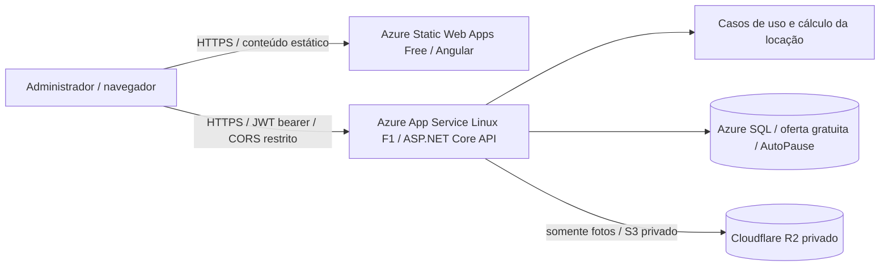
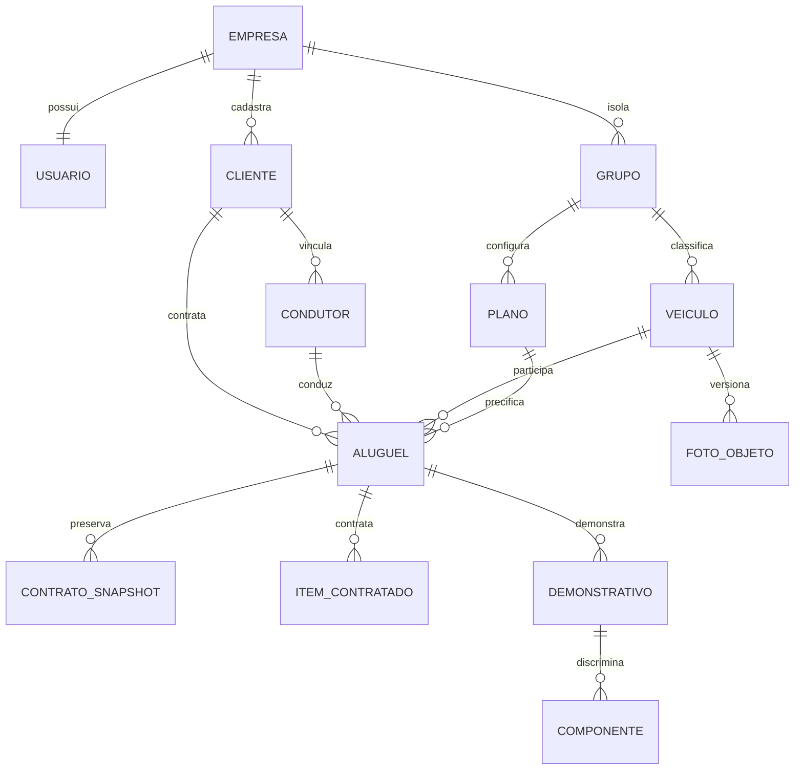
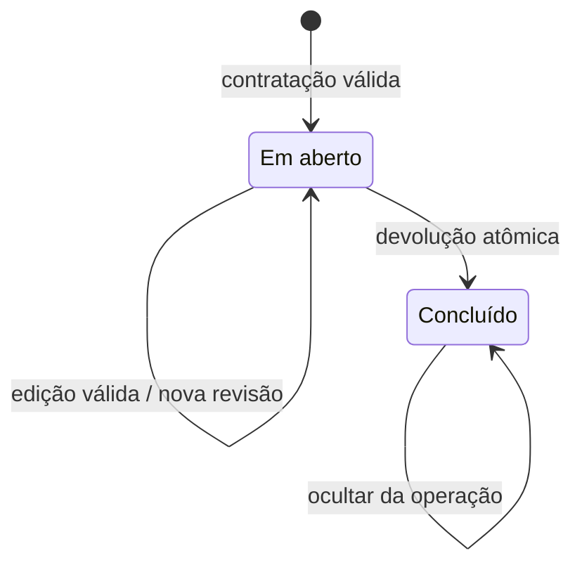

# TDD — Sistema Web para Gestão de Locadoras de Veículos

**Status:** Base de design técnico da v1

**Data:** 19/11/2026 (reorganização documental; versão anterior de 09/11/2026)

**Revisão documental:** 19/11/2026. O documento passa a seguir nove seções e adota, como alvo de design, as decisões de sessão, publicação, testes, Compose, segredos e workflow registradas abaixo. Não houve implementação.

**Contexto documental:** este TDD é a base de design da v1 e descreve o estado do repositório na `main`. Não registra código existente, versões instaladas, recursos provisionados nem testes executados. A branch `docs/tdd-locacao-veiculos` não existe e não faz parte deste documento. O [docs/prd.md](prd.md) continua sendo a fonte do escopo funcional e não foi modificado. A frase do PRD sobre preparação sem Git permanece naquele arquivo e não é corrigida aqui.

**Escopo:** v1 administrativa do PRD. Documento de design técnico, não plano de desenvolvimento orientado a testes e não descrição de sistema já construído.

**Decisor técnico:** solicitante, na revisão que originou este texto. Responsáveis nominais de engenharia, segurança, produto e operação não foram designados. Não houve revisão técnica independente.

**Fontes:** [docs/prd.md](prd.md), datado de 09/11/2026, status `Validado para TDD`. RF-01 a RF-19, RNF-01 a RNF-07, RN-01 a RN-09, J-01 a J-05 e CA-01 a CA-12 permanecem a referência funcional. As decisões de plataforma desta revisão estão escritas por completo neste arquivo. O domínio da locação não foi substituído pelo de outro produto.

**Condições de execução:** a verificação de versões da seção 2.1, os testes da seção 7, a escolha dos parâmetros de rate limit do registro, a instalação do schema `prototype-first` na abertura da segunda change (F2) e a verificação da oferta gratuita ainda precisam ocorrer. Não são decisões em aberto de sessão, topologia ou fase das fotos, nem resultados concluídos. Esta revisão não autoriza implementação, provisionamento, produção nem aprovação automática da SDD.

## 1. Resumo, objetivos e limites

Construir uma SPA administrativa Angular e uma API .NET para operar empresas isoladas, frota, clientes, condutores, preços, contratação e devolução. O desenho prioriza isolamento entre empresas, consistência sob concorrência e demonstrativos históricos verificáveis. A publicação gratuita da seção 6.1 é a arquitetura-alvo da última fase e ainda não foi provisionada.

Todo o escopo obrigatório do PRD integra a v1. Nenhuma fase anterior à F5 é uma v1 pronta. A F5 entrega as fotos obrigatórias dos veículos; não é uma versão futura. Incrementos intermediários não reduzem a v1.

### 1.1 Restrições de desenho

- Angular 22, TypeScript, componentes standalone, zoneless, Signals e Signal Forms. A validação de negócio continua no servidor.
- Tailwind CSS, Lucide e componentes próprios, sem Angular Material.
- .NET 10, solução `.slnx`, Clean Architecture, Entity Framework Core, SQL Server e ASP.NET Core Identity para senha e bloqueio.
- Português, BRL, fuso `America/Sao_Paulo`, conta administrativa única por empresa. Clientes e condutores não têm login.
- Código, testes e configurações da aplicação ficam em `app/`. Documentos, governança e ferramentas do repositório permanecem na raiz. O `compose.yml` da raiz é infraestrutura local, não código da aplicação.
- Desenvolvimento local primeiro: SQL Server Developer só no Compose de infraestrutura; API e Angular no host, em duas origens.
- Fotos privadas do veículo, com a API como proxy e bucket R2 privado, são obrigatórias na v1 e só entram na F5.
- A combinação Angular 22 e .NET 10 é o alvo. Patch, Node e lockfiles não são fixados neste documento.

### 1.2 Limites

Não desenhar funcionários, múltiplas contas ou perfis por empresa, reservas, cancelamento, reabertura, pagamentos, movimentação de caução, emissão fiscal, portal do cliente, manutenção ou integrações documentais e com seguradoras. Recuperação de senha e administração da plataforma continuam fora dos fluxos da v1, conforme a seção 5.2 do PRD. A perda da credencial única permanece risco operacional na seção 9; não é entrega de fase nem funcionalidade acrescentada.

Não existem metas aprovadas de carga, latência, disponibilidade, cobertura percentual, retenção, RPO ou RTO. Este documento não preenche esses itens com números de outro produto e não afirma conformidade legal, autenticidade de documentos nem prontidão operacional.

## 2. Registro central de decisões

Os identificadores DT-01 a DT-15 mantêm os temas já usados neste TDD e não foram renumerados. O texto é o que passa a valer. DT-16 a DT-21 registram decisões desta revisão que não cabiam no enunciado anterior sem esconder o tema. Nenhuma decisão abaixo descreve componente instalado, recurso Azure criado ou teste executado.

**Origem:** “PRD” é requisito do documento de produto; “entrevista anterior” é decisão já registrada no desenho de 09/11/2026 e mantida; “revisão de 19/11/2026” é a adoção, como alvo, das decisões de plataforma desta reorganização.

| ID | Tema | Decisão e estado | Origem/decisor | Justificativa, alternativas e consequências |
| --- | --- | --- | --- | --- |
| DT-01 | Frontend | **Definida como alvo, sem implementação:** Angular 22, TypeScript, componentes standalone, zoneless, Signals e Signal Forms. A validação de negócio permanece no servidor. | Revisão de 19/11/2026; a entrevista anterior já escolhia Angular 22, standalone, zoneless e Signals | Estado de tela com Signals e entrada com Signal Forms. Não usar Zone.js. Patches e Node ficam para a seção 2.1. |
| DT-02 | UI | **Definida como alvo:** Tailwind CSS, Lucide e componentes próprios acessíveis, sem Angular Material. | Revisão de 19/11/2026; entrevista anterior para Tailwind e componentes próprios | Menos dependência de kit visual. A equipe cobre teclado, foco, contraste, rótulos e erros associados ao campo. Versões exatas na seção 2.1. |
| DT-03 | Backend | **Mantida como alvo:** C# e .NET 10, ASP.NET Core com controllers REST, solução `.slnx` e monólito em Clean Architecture. | Entrevista anterior | Domain e Application independentes de transporte e infraestrutura. Uma unidade de deploy da API. Módulos internos são de locação, não deploys separados. |
| DT-04 | Persistência | **Definida como alvo:** SQL Server, EF Core e migrations versionadas. Local: SQL Server 2022, edição Developer, apenas no Compose. Publicação: Azure SQL na oferta gratuita da DT-16, ainda não criada. | Entrevista anterior, ajustada na revisão de 19/11/2026 | Transações e migrations no mesmo banco. Developer não é licença de publicação. A tag da imagem é fixada na F1. Sem SQLite e sem EF InMemory. |
| DT-05 | Sessão | **Definida como alvo:** Identity para senha e bloqueio. JWT próprio HS256, chave aleatória de 32 bytes por versão, `kid`, acesso de 15 minutos, tolerância de relógio de 30 segundos e rotação de assinatura a cada 90 dias como procedimento, não como job. Sessão SQL absoluta de 8 horas. Refresh opaco somente em memória na SPA e como hash no SQL. | Revisão de 19/11/2026 | A consulta de sessão em cada requisição atende o logout imediato de CA-01. A tolerância de 30 segundos é só do relógio do JWT e não altera a RN-08. Detalhe na seção 6.2. |
| DT-06 | CORS e cliente da sessão | **Definida como alvo:** SPA e API em origens distintas, no host durante o desenvolvimento, sem proxy de mesma origem. CORS pela origem exata, sem `AllowAnyOrigin` e sem `AllowCredentials`. Access token e refresh só em memória. Sem cookie, sem antiforgery, sem `localStorage`, `sessionStorage`, IndexedDB ou sessão entre abas. Recarga exige novo login. Reúso do refresh revoga a família. | Revisão de 19/11/2026 | Duas origens locais exercitam o mesmo tipo de chamada da publicação. CORS não autentica. XSS continua ameaça ao bearer em memória. |
| DT-07 | Multitenancy | **Mantida:** isolamento por `EmpresaId`, filtros de leitura, guarda de escrita e FKs compostas. A claim `empresaId` é resolvida no servidor a partir da conta e da sessão. O identificador enviado pelo cliente não escolhe a empresa. Uma conta administrativa por empresa. Clientes e condutores não autenticam. | Entrevista anterior e PRD | Banco ou schema por empresa teria outro custo operacional e não é o desenho. SQL direto e histórico precisam manter o tenant. |
| DT-08 | Histórico e unicidade | **Mantida** a preservação por snapshots, exclusão lógica e preço de combustível versionado por vigência. **Definida nesta revisão:** CPF de cliente PF, CNPJ de cliente PJ, CPF de condutor e placa são únicos apenas entre registros ativos da mesma empresa. | Entrevista anterior; unicidade ajustada na revisão de 19/11/2026 | A exclusão lógica libera o identificador para um registro novo, que é outra identidade. Contratos, snapshots e demonstrativos continuam ligados ao registro original. O mesmo CPF pode ser cliente e condutor quando o PRD já permite. |
| DT-09 | Tempo e dinheiro | **Mantida:** dinheiro em `decimal`; transporte decimal em strings; instantes em UTC; fuso `America/Sao_Paulo`. O servidor é a autoridade do cálculo, inclusive RN-01 a RN-09. | Entrevista anterior e PRD | Evita ponto flutuante e dia civil como duração. O navegador não fecha valor. |
| DT-10 | Consistência | **Mantida:** transação SQL, bloqueio das escritas da empresa, índice único de um aluguel aberto por veículo, `rowversion`/ETag e idempotência dos comandos de contrato. | Entrevista anterior e RNF-03 | O índice sozinho não protege alterações simultâneas de cadastro. Menor paralelismo por empresa é aceito no início local e não é promessa de capacidade. |
| DT-11 | Fotos na v1 | **Definida:** fotos privadas do veículo são obrigatórias na v1 e implementadas somente na F5. A F2 grava e edita os dados do veículo, sem upload nem gerenciamento de foto. A F5 integra a foto ao cadastro pelo desenho já existente: API como proxy, bucket R2 privado e sem URL pública. Um veículo pode ser gravado sem foto anexada, porque RF-06 e CA-03 o permitem. | PRD; revisão de 19/11/2026 para a fase | Essa permissão de gravar o veículo sem arquivo não torna a funcionalidade opcional nem a empurra para versão futura. Nenhuma fase anterior à F5 é v1 pronta. |
| DT-12 | Limites da imagem | **Mantida:** JPEG e PNG, 5 MiB e 16 megapixels. SkiaSharp decodifica e reencoda sem metadados. No desenvolvimento, o adaptador local de armazenamento usa volume privado. | Entrevista anterior | WebP, 20 megapixels, cinco imagens por registro e cotas de 70% e 80% não fazem parte deste desenho. SQL e armazenamento de objeto não compartilham uma transação. |
| DT-13 | Contratos HTTP | **Mantida:** DTOs, validação explícita, mapeamento manual, OpenAPI, prefixo `/api/v1` e ProblemDetails. Sem MediatR, AutoMapper ou FluentValidation. | Entrevista anterior | Mais código explícito e menos dependências. Invariantes continuam no domínio. |
| DT-14 | Testes | **Definida como alvo, sem execução:** MSTest para unidade e integração, `WebApplicationFactory` e SQL Server real. Vitest e Playwright permanecem. A matriz de UI inclui Signal Forms. | Revisão de 19/11/2026 | Sem SQLite, EF InMemory ou Testcontainers. SQL real verifica locks, índices e `rowversion`. Nenhum teste deste documento está marcado como executado. |
| DT-15 | Observabilidade | **Definida como alvo:** logs estruturados pelo `ILogger` nativo, sem Serilog. Health de processo, sem consulta contínua ao SQL. Auditoria de negócio no SQL, na mesma transação da mudança crítica. CI é mudança própria; não há workflow presumido. | Entrevista anterior, ajustada na revisão de 19/11/2026 | A seção 6.1 proíbe keep-alive artificial diante do AutoPause. Destino de logs, retenção e metas numéricas continuam sem aprovação do PRD. |
| DT-16 | Publicação | **Arquitetura-alvo da F6, sem recurso criado:** Angular no Static Web Apps Free; API no App Service Linux F1, com preferência por East US e chamada HTTPS direta; Azure SQL na oferta gratuita com `useFreeLimit=true` e `freeLimitExhaustionBehavior=AutoPause`, nunca `BillOverUsage`. | Revisão de 19/11/2026 | Sem BFF, sem proxy pago do Static Web Apps e sem plano pago automático. Se a oferta gratuita não couber, parar e revisar. Identidade gerenciada para o SQL e segredos em App Settings. O PRD não aprova RPO, RTO nem quantidade de cópias. |
| DT-17 | Segredos | **Definida como alvo:** parâmetros não sensíveis em `appsettings`; User Secrets em Development; App Settings na publicação. Arquivo versionado não contém segredo. | Revisão de 19/11/2026 | Sem serviço adicional de cofre como dependência obrigatória da v1. User Secrets não é mecanismo de publicação. |
| DT-18 | Compose e migrations | **Definida como alvo:** `compose.yml` na raiz, somente infraestrutura, com SQL Server Developer, healthcheck e volume nomeado. API e Angular no host. `Database.MigrateAsync()` apenas em Development. Fora de Development, sem migration automática. | Revisão de 19/11/2026 | Não há seed de contas sintéticas de funcionários. O RF-01 exige o registro público da empresa. A conta administrativa local do Developer não é reutilizada fora de Development. |
| DT-19 | Login | **Definida, somente no login:** senha mínima de 8 caracteres, bloqueio de 15 minutos após 5 falhas e 5 requisições por minuto por IP, sem fila. Erro genérico e `429` quando a taxa do login estoura. | Revisão de 19/11/2026 | O registro persiste a senha pelo mesmo Identity e não conclui com senha que essa política rejeita. Bloqueio, janela e taxa por IP do login não são o rate limit do registro. Sem exigência extra de composição de senha. |
| DT-20 | Rate limit do registro | **Obrigatória; parâmetros ainda não escolhidos:** o registro público e não autenticado tem rate limit. Limite, janela, identificação e mecanismo ficam para a SDD da F1. | Revisão de 19/11/2026 e RF-01 | Os números da DT-19 não são copiados para esse endpoint. A F1 não pode sair sem a proteção especificada e verificada. |
| DT-21 | Workflow das fases | **Definida para o trabalho futuro:** cada fase nasce em feature branch. A primeira change, a F1, usa o workflow `spec-driven`: proposal, specs, design e tasks antes do código. A partir da segunda change, a F2, o schema passa a `prototype-first`, no mesmo momento de transição do Gestão de Estacionamento: proposal, specs, protótipo quando houver tela, design e tasks antes do código. Evidência e checklist só depois da verificação. Sync e archive no fechamento. | Revisão de 19/11/2026 | O [openspec/config.yaml](../openspec/config.yaml) permanece em `spec-driven` na F1. O schema `prototype-first` ainda não foi instalado. A instalação e a seleção nesse arquivo ocorrem na abertura da F2. Esta revisão não altera esse arquivo. |

### 2.1. Seleção de versões e reprodutibilidade

A combinação-alvo é Angular 22 e .NET 10. Antes de implementar, verificar a disponibilidade e a compatibilidade dessas versões, selecionar os patches e a versão de Node, e registrar SDKs, manifests e lockfiles. A combinação precisa passar por restore, build e testes locais na abertura da implementação. Esta revisão não fixa patch, Node nem lockfile e não copia esses valores de outro repositório, de badge ou de README. Atualizações futuras repetem a verificação. Intervalo de versão e badge não demonstram compatibilidade.

## 3. Arquitetura e organização



O diagrama é a topologia-alvo da F6, não um inventário de recursos existentes. Nenhum Static Web App, App Service ou Azure SQL foi provisionado. A SPA é carregada do Static Web Apps Free e chama a URL HTTPS da API no App Service. `/api/v1` é caminho da API, não proxy na origem da SPA. O R2 aparece somente no caminho das fotos, a partir da F5; o navegador não o acessa. No desenvolvimento, a API e o Angular rodam no host, em origens distintas, e o SQL Server Developer roda apenas no `compose.yml`.

**Fronteira de confiança (DT-05, DT-06, DT-07, DT-11 e DT-16):** toda operação protegida revalida JWT, sessão, conta e versão no servidor. A claim `empresaId` sai da conta e da sessão, não de cabeçalho, corpo ou query enviados pelo cliente. CORS lista origens exatas e não usa `AllowAnyOrigin` nem `AllowCredentials`. Não há cookie e, por isso, não há antiforgery. API para SQL e API para R2 usam segredo ou identidade somente no servidor.

Dependências de compilação: Application → Domain; Infrastructure → Application e Domain; Api → Application, e Infrastructure apenas na composição. Domain não referencia EF, Identity, HTTP, SDK S3 ou Angular. A Api não contém regra de cálculo.

| Módulo | Responsabilidade | RF e fase |
| --- | --- | --- |
| Acesso | Registro atômico de empresa e conta, login, refresh, consulta de sessão, logout, CORS e tenant | RF-01 a RF-03; F1 |
| Frota e preços | Grupos, planos, dados do veículo, seguros, combustíveis e taxas. Foto fora deste módulo até a F5 | RF-04 a RF-07 e RF-11 a RF-13; F2, foto na F5 |
| Pessoas | PF e PJ, vínculos, condutores, elegibilidade e coerência de CNH | RF-08 a RF-10; F2 |
| Locações | Contrato aberto, edição, estimativa, devolução, cálculo e histórico | RF-14 a RF-19; F3 e F4 |
| Fotos | Proxy privado, metadados, leitura autorizada e compensação, integrados ao veículo | RF-06 e RNF-01; F5 |
| Transversal | Contexto de empresa, auditoria, idempotência, relógio e erros | RNF-01 a RNF-07 |

Um `DbContext` derivado de `IdentityDbContext` reúne identidade e dados do monólito, para o registro da empresa e da conta na mesma transação. A Application depende de portas específicas e de unidade de trabalho. Não usar repositório genérico que esconda lock ou force materialização. O relógio de teste usa `TimeProvider`.

### 3.1 Organização proposta, não criada

```text
compose.yml                      infraestrutura local; ferramenta do repositório, não publicação
app/
  backend/
    Locadora.slnx
    src/Locadora.Domain/
    src/Locadora.Application/
    src/Locadora.Infrastructure/
    src/Locadora.Api/
    tests/Locadora.Domain.Tests/
    tests/Locadora.Application.Tests/
    tests/Locadora.IntegrationTests/
    global.json
    Directory.Packages.props
  frontend/
    src/app/core/                 sessão em memória, HTTP e erros
    src/app/shared/               controles acessíveis e formatação
    src/app/features/             acesso, frota, pessoas, preços e locações
    package.json
    package-lock.json
  e2e/
docs/prd.md
docs/tdd.md
openspec/                        spec-driven na F1; prototype-first a partir da F2, ainda não instalado
.github/                         governança; CI não está presumida
```

Nada dessa árvore de aplicação foi criado por este documento. Migrations pertencem à Infrastructure. O `compose.yml` fica na raiz porque é ferramenta de infraestrutura do repositório; código, testes e configuração da aplicação continuam em `app/`. A porta do SQL é publicada só no loopback.

### 3.2 Frontend

Rotas lazy por funcionalidade, componentes standalone e estado em serviços com Signals e `computed`. Signal Forms fazem a entrada e a validação de tela. RxJS atende HTTP, cancelamento e eventos, com descarte no ciclo de vida. O servidor continua sendo a autoridade das regras de negócio.

Guard de rota melhora a navegação e não substitui a autorização da API. O interceptor anexa `Authorization: Bearer` somente à URL da API configurada, sem `withCredentials`, e nunca envia o token ao R2 ou a um destino arbitrário. Tokens e refresh existem só em memória: sem `localStorage`, `sessionStorage`, IndexedDB ou compartilhamento entre abas. Recarga exige novo login. Não há SSR, service worker nem cache offline de dados pessoais na v1.

Listagens têm estados de carregando, vazio e erro, com filtros e paginação. Formulários exibem resumo e erros por campo, preservam foco e não dependem só de cor. Moeda em BRL e datas no fuso aprovado; o envio usa formato canônico. Estimativa e valor final são visualmente distintos, com quilômetros pendentes e caução separada.

## 4. Modelo de dados, estados e concorrência

### 4.1 Convenções

- IDs opacos, GUID gerados pelo servidor. Não autorizam por si só.
- Tabelas da empresa: `Id`, `EmpresaId`, criação e alteração em UTC, e `rowversion` nas entidades mutáveis. Cadastros excluíveis têm `ExcluidoEmUtc`. Aluguel concluído ocultado recebe essa marca e conserva o contrato.
- A chave alternativa `(EmpresaId, Id)` sustenta FKs compostas nas relações de negócio, inclusive itens, foto e demonstrativo.
- Documentos e placa têm forma normalizada para comparação. Pontuação é apresentação. Strings têm tamanho máximo no schema e no OpenAPI, definido com amostras válidas na SDD. Não truncar em silêncio um dado exigido pelo PRD.
- Preços unitários em `decimal(19,6)`; totais e componentes arredondados em `decimal(19,2)`; litros e capacidade em `decimal(12,3)`; quilômetros, franquia e hodômetros como inteiros não negativos. Validar limite e overflow antes de multiplicar. Não arredondar a entrada em silêncio.
- Instantes em `datetimeoffset` UTC. Validade de CNH em `date`. Nenhuma diária é contada por mudança de data no calendário.

### 4.2 Modelo lógico

| Entidade | Campos e relações relevantes |
| --- | --- |
| Empresa | ID técnico. Não exigir nome empresarial, CNPJ ou dado além do RF-01 |
| Usuario Identity | `EmpresaId` único, username normalizado único na plataforma, e-mail e hash de senha. Uma conta por empresa |
| Sessao / Refresh | Usuário, empresa, versão de acesso, expiração absoluta e revogação. Hash do refresh, família e consumo para detectar reúso |
| Grupo | Nome, planos e veículos |
| Plano | Grupo, modalidade Diário, Controlado ou Livre, diária e parâmetros da modalidade. No máximo uma configuração por modalidade e grupo |
| Veiculo | Campos do RF-06, grupo, combustível, capacidade e referência opcional à foto ativa. A ausência da foto não impede gravar o veículo |
| FotoObjeto | Empresa, veículo, URL estável da API, bucket e chave gerados internamente, MIME, tamanho, hash e estado do upload. Sem bytes na linha |
| Cliente | Tipo PF ou PJ, dados comuns, endereço e e-mail opcional. Documentos conforme o tipo |
| VinculoCliente | Relação PF–PJ de clientes da mesma empresa, sem conta e sem responsabilidade de funcionário |
| Condutor | Cliente contratante, CPF, CNH, validade e contatos do RF-09. Pessoa física |
| TaxaServico | Nome, preço e modalidade fixa ou diária. O contrato guarda cópia |
| PrecoSeguro | Empresa, tipo Cliente ou Terceiros, e preço diário |
| PrecoCombustivel | Empresa, tipo, preço unitário e início de vigência UTC gerado pelo servidor |
| Aluguel | Estado, cliente, condutor, veículo, plano, saída, previsão, retorno, hodômetros, litros finais, caução e versão |
| ContratoSnapshot | Dados exibíveis do contratante, do condutor, do veículo, do grupo, do plano e dos parâmetros, copiados por versão contratual |
| ItemContratado | Identidade de origem, nome, categoria, modalidade e preço capturado. Origem na contratação, na edição ou na devolução |
| Demonstrativo / Componente | Estimativa ou final, versão da regra, entradas, D, K, franquia, preços, valores brutos, arredondados e total. O final é imutável |
| Auditoria | Empresa, ator, instante, ação, entidade, ID, correlação e campos alterados, sem valores pessoais |
| ComandoIdempotente | Empresa, ator, operação, chave, hash do comando, estado e referência ao resultado persistido |
| TrabalhoObjeto | Compensação ou remoção de objeto, com chave, tentativas e próximo processamento. Sem URL assinada |



O diagrama omite tabelas transversais. Cada aluguel guarda um cliente, um condutor, um veículo e um plano. CNH no cliente PF não elimina o condutor nem o vínculo do RF-10. Relação PF–PJ não torna todos os condutores elegíveis: o condutor selecionado precisa estar vinculado ao contratante.

### 4.3 Invariantes e índices

- Username normalizado é único na plataforma. `EmpresaId` é único no usuário. O registro cria empresa e usuário na mesma transação e não deixa empresa órfã se falhar.
- Placa, CPF de cliente PF, CNPJ de cliente PJ e CPF de condutor são únicos entre registros ativos da mesma empresa, por índice filtrado em que `ExcluidoEmUtc` é nulo. A exclusão lógica libera o identificador para um registro novo, que é outra identidade. Contratos, snapshots e demonstrativos permanecem ligados ao ID original, não ao identificador reaproveitado. Conflito entre ativos informa o impedimento e não restaura nem sobrescreve o registro excluído.
- O mesmo CPF pode existir como cliente e como condutor quando o RF-09 já permite, inclusive quando o cliente PF é o próprio condutor. Essa coincidência não afrouxa a unicidade dentro de cada papel.
- `(EmpresaId, GrupoId, Modalidade)` é único para planos. Atualizar a configuração; não duplicar a modalidade.
- Índice único filtrado `(EmpresaId, VeiculoId)` no estado Em aberto. Um aluguel aberto não pode ser ocultado. A exclusão lógica de veículo não substitui essa regra.
- Índices para `(EmpresaId, Estado, SaidaUtc, Id)`, `(EmpresaId, GrupoId, Id)`, vínculos de cadastro com aluguel aberto e vigência de combustível `(EmpresaId, Tipo, InicioVigenciaUtc)`.
- Constraint de item impede repetir a mesma taxa ou o mesmo seguro pela mesma identidade de origem no aluguel. Taxa já contratada não entra de novo na devolução.
- Checks de valor não negativo, capacidade positiva, campos próprios de cada modalidade, retorno previsto posterior à saída, litros dentro da capacidade contratada e hodômetros válidos. O domínio valida, e o banco reforça o que for expressável.
- FKs de contrato sem cascade físico. A exclusão lógica aplica os bloqueios de RF-04 a RF-11. Plano usado em qualquer aluguel não é excluível.

### 4.4 Histórico e preços

O snapshot não depende de join com o cadastro atual para mostrar o contrato. Na contratação, copiar nomes e documentos necessários, identificação do veículo, capacidade, tipo de combustível, plano e preços. Editar cadastro não reescreve contrato existente. Excluir o cadastro também não reescreve o contrato: o histórico continua no registro original, mesmo que um cadastro novo reuse o documento ou a placa.

Edição de aluguel gera revisão. Itens mantidos conservam o valor. Itens substituídos ou incluídos capturam o preço atual e os dados novos pertinentes. Revisões anteriores continuam auditáveis. Só a revisão corrente conduz a devolução. Aluguel concluído e demonstrativo final não têm rota de edição nem de reabertura.

Preço de combustível é append-only. A configuração acrescenta vigência a partir do relógio do servidor e não altera período passado. Na devolução retroativa, usar o último preço cujo início de vigência seja menor ou igual ao retorno real informado. Se não existir, bloquear cálculo e conclusão. Não aplicar preço posterior em silêncio. Não permitir vigências sobrepostas de forma ambígua. Empate resolve-se pela ordem serial da alteração e pelo identificador da versão.

O demonstrativo final copia o preço e a versão de combustível aplicados, os demais preços, as entradas, os componentes, a regra e os instantes. Ocultar aluguel concluído não apaga essas informações. Consulta histórica inclui ocultos só por opção explícita e autorizada. O filtro de exclusão não desliga o isolamento por empresa.

### 4.5 Transações e concorrência

Na v1, toda mutação de negócio da empresa começa com transação e bloqueio de atualização da linha Empresa, mantido até o commit (`UPDLOCK`/`HOLDLOCK` no SQL Server, só na Infrastructure). Alteração e exclusão de cadastro, preço e confirmação de upload seguem o mesmo protocolo. Ele serializa as escritas da empresa e elimina a corrida entre validar um vínculo e alterá-lo. Consulta pura não adquire esse lock. Leitura que autoriza escrita ocorre dentro da transação protegida.

O índice único continua sendo a defesa final contra duas locações abertas do mesmo veículo. `rowversion` na raiz Aluguel e nas entidades mutáveis detecta tela desatualizada. Alterar item incrementa também a versão da raiz. A transação é curta e não inclui chamada ao R2, processamento de imagem nem interação humana.

Disponibilidade é a inexistência de aluguel Em aberto, não um booleano redundante no veículo. Criar e ocupar são a mesma inserção. Concluir e liberar são a mesma transição confirmada. Troca de veículo em aluguel aberto revalida o novo, libera o anterior e altera os snapshots na mesma transação. A saída original é imutável. Edição não cria reserva nem desloca o início para o futuro.

Alterar cliente PF que também é condutor exige CNH coerente em todos os registros correspondentes: atualização coordenada quando permitida; se o condutor tiver aluguel aberto, rejeitar mudança incompatível. Revalidar documento e vínculo em toda alteração relevante do aluguel. A devolução não revalida vencimento de CNH ocorrido depois da contratação. Atualização genérica não contorna esse serviço.

Falha de constraint vira conflito de negócio, nunca resposta SQL crua. Deadlock ou erro transitório permite retry limitado da transação inteira, com nova leitura e a mesma chave idempotente. Não repetir só o último `SaveChanges`. Conflito de ETag exige recarregar; não há retry automático que sobrescreva a intenção de quem usa. A serialização por empresa é hipótese aceitável para o início local, não promessa de capacidade.



Não há cancelamento, retorno a Em aberto nem edição de concluído.

### 4.6 Cálculo da locação e representação temporal

O serviço puro de domínio produz estimativa e valor final. Somente o servidor é autoridade (DT-09). A API transporta decimais em string com ponto, por exemplo `"1000.00"`. Entrada com escala excessiva ou fora do intervalo é rejeitada. A UI formata em português e não converte o cálculo para `number`.

| Regra | Desenho e verificação |
| --- | --- |
| RN-01 | Saída capturada no servidor na criação. `D = máximo(1, teto((retorno UTC − saída UTC) / 24h))`. Exibição no fuso de São Paulo. Duração transcorrida, não dias civis |
| RN-02 | Hodômetros inteiros. `K = final − inicial`. A estimativa informa quilômetros não apurados e não finge `K = 0` como total final |
| RN-03 | Diário: `B` bruto `= D × diária + K × preço/km` |
| RN-04 | Controlado: franquia total `= D × franquia diária`. `B` bruto `= D × diária + máximo(0, K − franquia total) × excedente` |
| RN-05 | Livre: `B` bruto `= D × diária`. Quilômetros são registrados e não são cobrados |
| RN-06 | Um componente para cada taxa e cada seguro. Fixa uma vez; diária por `D`. Taxa incluída no retorno usa o `D` efetivo completo |
| RN-07 | Reposição `= (capacidade contratada − litros finais) × preço do combustível vigente no retorno`. Tanque cheio gera zero. Sem preço vigente, o cálculo e a conclusão ficam bloqueados mesmo quando a reposição seria zero |
| RN-08 | Arredondar `B`. Se o retorno real for posterior ao previsto, multa única `= arredondar(0,10 × B)`. Sem tolerância de atraso e sem incidência sobre adicionais |
| RN-09 | Arredondamento decimal de meio para cima, por `AwayFromZero` nos valores não negativos. Somar componentes já arredondados. Caução `= 1000.00`, separada e sem efeito no custo |

`B` é um componente monetário. Registrar os termos de diária e quilômetro para explicação, somar os brutos e arredondar `B` antes da multa. Não arredondar cada termo intermediário de um modo que mude `B`. Cada taxa, cada seguro, o combustível e a multa são componentes separados, arredondados antes do total. Persistir o bruto com precisão suficiente, sem reduzir em silêncio o valor usado.

A estimativa devolve as parcelas conhecidas e um indicador de incompletude. Diário e Controlado têm quilômetros pendentes. Combustível e eventual atraso não ficam garantidos na contratação. O plano Livre elimina a pendência de quilômetro e não transforma a reposição futura em preço definitivo. A caução nunca compõe subtotal nem total.

Data e hora da API entram em ISO 8601 com offset explícito. O servidor normaliza para UTC e valida a correspondência com o fuso do negócio quando a entrada representar horário local. A UI converte de forma explícita e não depende do fuso do dispositivo. Rejeitar horário local inexistente e exigir desambiguação na transição de fuso. CNH válida até o dia local do retorno previsto é elegível nesse dia. O relógio de teste cobre offsets e transições históricas e não fixa São Paulo como UTC−3 para todas as datas.

## 5. Interfaces, autorização e sequências

### 5.1 Convenções

Os contratos abaixo são desenho. Não são endpoints existentes. A especificação OpenAPI e os testes nascem na SDD e na implementação.

- JSON em `/api/v1`, campos em camelCase, enums com nome estável e IDs em string. Empresa e ator vêm da sessão. Corpo, query e cabeçalho do cliente não escolhem a empresa.
- Listas: `page`, `pageSize`, filtros permitidos e ordenação estável com ID no desempate. Envelope `items`, `page`, `pageSize` e `total`. Padrão técnico inicial de 20 itens, máximo de 100, sujeito a medição e sem ser SLO.
- GET de entidade mutável devolve `ETag` opaco derivado de `rowversion`. PUT, DELETE e devolução exigem `If-Match`. Ausência: 428. Versão diferente: 412.
- ProblemDetails com `status`, `title`, `code`, `traceId` e, quando couber, mapa `errors` por campo. Sem documento completo, senha, stack trace ou SQL.
- 400 formato ou validação; 401 sessão ou token inválido; 403 política de autorização; 404 inexistente ou de outra empresa; 409 vínculo, disponibilidade, estado ou chave idempotente; 413 arquivo excedido; 415 mídia não aceita; 429 taxa do login ou, no registro, o limite que a SDD da F1 definir; 503 dependência indisponível. Criação 201 com `Location`; edição 200; exclusão lógica 204.
- `Idempotency-Key` obrigatória na criação do aluguel e na devolução. Unicidade por empresa, ator e operação. O hash canônico do comando inclui o recurso e não inclui o JWT. A mesma chave com o mesmo comando devolve o resultado original. Outra entrada na mesma chave devolve 409. Guardar referência ao resultado, sem duplicar dado pessoal num cache de resposta.
- Verificar replay idempotente antes do ETag corrente. Só operação nova exige a precondição atual. O registro idempotente e o efeito de negócio usam o mesmo commit. Timeout depois do commit resolve-se repetindo a mesma chave.
- Não há cookie de autenticação e não há endpoint antiforgery. Rotas de negócio aceitam bearer. Login, refresh, consulta de sessão e logout usam o prefixo `/api/v1/session`. O registro público fica ao lado desse prefixo.

Login, conforme DT-19: senha mínima de 8 caracteres; 5 requisições por minuto por IP, sem fila; bloqueio da conta por 15 minutos após 5 falhas. Resposta `429` quando a taxa do login estoura, com correlação e sem revelar se a conta existe. Credencial inválida ou bloqueio usam erro genérico. Considerar o IP só por cadeia de proxy confiável. Login, refresh e logout não são cacheáveis. Senha e token não entram em log.

O registro público tem rate limit obrigatório (DT-20). Os números do login não definem esse limite. A SDD da F1 escolhe limite, janela, identificação e mecanismo antes da implementação correspondente.

### 5.2 Catálogo de contratos

| Rotas | Entradas e saídas principais | Regras |
| --- | --- | --- |
| `POST /api/v1/registro` | username, email e password → empresa e conta criadas | Público, não autentica e não pede dado empresarial além do RF-01. Rate limit obrigatório, com parâmetros da SDD da F1. Username único na plataforma |
| `POST /api/v1/session/login` | username e password → JWT, refresh opaco, expiração e dados mínimos | Erro genérico. Nova sessão absoluta de 8 horas. Aplica a DT-19. Resposta `no-store` |
| `POST /api/v1/session/refresh` | refresh no corpo JSON → novo JWT e refresh rotacionado | O refresh não viaja em cookie nem em URL. Não depende de JWT ainda válido. Reúso revoga a família |
| `GET /api/v1/session` | identidade mínima da conta e da empresa | Bearer, sessão ativa e versão de acesso conferida no SQL |
| `POST /api/v1/session/logout` | bearer e sessão → 204 | Revoga sessão e família no SQL. Repetição segura. Apagar memória no cliente não é a revogação |
| `/grupos`, `/planos`, `/veiculos` e `/{id}` | GET, POST, PUT e DELETE dos campos de RF-04 a RF-06, exceto o binário da foto na F2 | Planos condicionais por modalidade. Filtro `grupoId`. A F2 não recebe upload de foto |
| `/clientes`, `/condutores` e `/{id}` | CRUD lógico com RF-08 e RF-09 | Discriminador PF/PJ, vínculo e CNH coerente. CPF e CNPJ validados localmente. Unicidade só entre ativos |
| `/clientes/{id}/vinculos-pj` | consultar, adicionar e remover vínculos PF–PJ | Somente clientes compatíveis da mesma empresa |
| `/taxas-servicos` e `/{id}` | CRUD lógico com nome, preço e modalidade | Bloqueio de edição e exclusão com aluguel aberto |
| `GET/PUT /configuracoes/seguros/{tipo}` | preço diário por tipo, ou indicação de não configurado | Não criar preço implícito zero. Preço zero explícito é permitido |
| `GET/PUT /configuracoes/combustiveis/{tipo}` | preço e vigência atribuída pelo servidor | PUT acrescenta versão vigente e não edita o passado |
| `GET /alugueis` e `GET /alugueis/{id}` | listagem do RF-16, contrato e demonstrativo | Filtros de estado, veículo, período e inclusão explícita de ocultos |
| `POST /alugueis/estimativas` | dados de contratação, sem saída editável → parcelas conhecidas | Não ocupa veículo. Informa que a criação recalcula |
| `POST /alugueis` | cliente, condutor, veículo, plano, retorno previsto, hodômetro inicial, taxas e seguros → aberto | O servidor captura saída e preços. Exige idempotência |
| `PUT /alugueis/{id}` | campos editáveis da contratação, sem saída, estado ou valor final → revisão atual | Só Em aberto, com ETag. Item mantido preserva preço; item novo usa o preço atual |
| `POST /alugueis/{id}/devolucao/previa` | retorno real, hodômetro final, litros e taxas adicionais → cálculo proposto | Não conclui. Devolve as versões usadas |
| `POST /alugueis/{id}/devolucao` | os mesmos dados e as versões aceitas na prévia → final | ETag e idempotência. Se preço ou configuração mudou, 409 e nova prévia |
| `DELETE /alugueis/{id}` | sem body → ocultação lógica | Só concluído. Não apaga contrato |
| `PUT/GET/DELETE /veiculos/{id}/foto` | multipart no upload, leitura binária e remoção lógica da referência | Somente na F5. Empresa da sessão e bloqueio se houver aluguel aberto. Nunca aceitar URL externa |

Os campos obrigatórios são os do PRD. A API não torna e-mail obrigatório no cliente, não acrescenta dado empresarial e não dispensa o condutor. Validade de CNH, CPF e CNPJ são validações dos dados informados, sem consulta oficial.

### 5.3 Contratação e devolução

```mermaid
sequenceDiagram
    actor Adm as Administrador
    participant UI as Angular
    participant API as API e casos de uso
    participant DB as SQL Server
    Adm->>UI: Confirmar contratação
    UI->>API: POST aluguel, bearer e Idempotency-Key
    API->>DB: Reconsultar sessão, conta e versão; transação e lock da Empresa
    API->>DB: Replay, vínculos, documentos, preços e disponibilidade
    API->>DB: Inserir aberto, snapshots, estimativa, auditoria e resultado
    DB-->>API: Commit, com o índice único protegendo o veículo
    API-->>UI: 201, ETag e parcelas conhecidas
    Adm->>UI: Informar devolução e aceitar a prévia
    UI->>API: POST devolução, If-Match, chave e versões da prévia
    API->>DB: Sessão, transação, lock, replay, estado e versões
    API->>API: Calcular com preços e entradas validados
    API->>DB: Final imutável, estado Concluído, auditoria e resultado
    DB-->>API: Commit; o veículo deixa de ter aluguel aberto
    API-->>UI: 200 e demonstrativo final
```

Repetir a conclusão com a chave original devolve o resultado persistido. Outra chave em aluguel concluído gera conflito e não cobra de novo. Falha antes do commit não muda a disponibilidade. Comando concorrente de edição ou devolução perde por ETag ou por estado e não reabre o aluguel.

### 5.4 Sessão no Angular

O shell usa rotas, Signals, Signal Forms e guard de sessão. O guard resolve o estado antes de navegar e envia quem não está autenticado ao login. A API e os casos de uso é que autorizam.

O interceptor anexa o bearer só à API configurada. `401` leva à reautenticação definida na seção 6.2, sem renovar por cookie. `403` informa acesso negado e não prova rollback de um comando anterior. O logout revoga no servidor antes de limpar a memória. Se a rede falhar, a interface informa que a revogação remota não foi confirmada.

Tentativa de negócio ainda incerta permanece só em memória, com a mesma chave e o mesmo conteúdo, bloqueio de navegação enquanto a tentativa não se resolver e aviso antes de sair. Recarga ou fechamento do navegador perde esse conteúdo. Não há sessão entre abas. O replay depois de novo login exige o mesmo ator e o mesmo comando.

Formulários inválidos mostram mensagem textual e resumo focado. Campo inválido recebe `aria-invalid` e associação ao resumo. Testes automatizados de mensagem e foco não substituem avaliação manual de teclado e tecnologia assistiva, e não certificam acessibilidade.

### 5.5 Fotos privadas

Esta seção é o desenho que a F5 implementa. A F2 não envia, não lê e não remove foto. O veículo continua podendo ser gravado sem foto anexada. Bucket R2 sem domínio público. O SDK recebe o endpoint do R2 e a região aceita pelo SDK verificado na abertura da F5. Credencial mínima, limitada ao bucket, fica fora do navegador. O cliente não envia URL para a API buscar, para não abrir SSRF.

1. Autorizar sessão e empresa e validar o ETag do veículo. Limitar o corpo a 5 MiB. Validar assinatura, dimensões positivas e o produto largura × altura até 16 milhões de pixels antes de alocar. Aceitar só JPEG e PNG estáticos. Rejeitar arquivo truncado, animação e formato divergente. Reencodar os pixels para remover EXIF e outros metadados. Limitar também a saída, a memória, o tempo e a concorrência do processamento. Reencodar não é antivírus.
2. Criar registro pendente numa transação curta, com chave aleatória por empresa e upload. Pendência não é foto ativa e não aparece na listagem.
3. Enviar a imagem saneada ao R2 fora da transação. Confirmar o objeto esperado. Retry usa a mesma chave, nunca o nome original nem um documento.
4. Nova transação com o lock da empresa: revalidar veículo, ETag e ausência de aluguel aberto. Ativar a referência só depois que o objeto existir, atualizar a versão do veículo e auditar. Se o veículo foi alugado ou alterado durante o upload, não ativar e agendar compensação.
5. Na substituição, tornar a referência anterior inacessível na API e registrar o trabalho de remoção. A exclusão física depende da política de retenção, que o PRD ainda não aprova. Não apagar objeto ainda necessário ao histórico. Falha ou reinício deixa pendência identificável.

A compensação fica durável no SQL, com tentativas e remoção idempotente. Não há laço contínuo nem health check só para manter o SQL acordado. Pendências são retomadas na inicialização da API ou na operação seguinte. Limpeza não inclui objeto ativo. Falha final fica registrada e não some em silêncio. Backup e restauração conjuntos de referências e objetos continuam pendência da seção 9, sem meta numérica.

A leitura é GET autenticado na API: sessão, `EmpresaId`, streaming do objeto esperado, MIME saneado, `nosniff` e `Cache-Control: private, no-store`. O Angular obtém o blob com o bearer e cria object URL temporária, revogada ao sair da tela ou no logout. `` direto não envia `Authorization`. Não persistir object URL, URL assinada nem URL pública. A URL gravada é relativa à API. Bucket e chave são metadados internos. Não redirecionar o navegador ao armazenamento.

Se o R2 estiver indisponível, a foto falha ou mostra placeholder acessível. Consulta e locação que não precisam da imagem continuam. Upload fracassado preserva a foto ativa anterior. No local, a porta de armazenamento usa volume privado e o mesmo protocolo; isso não prova o R2. Prova em bucket isolado é critério da F5, sem criar conta nesta revisão.

## 6. Segurança, operação e implantação

| Ameaça | Defesa exigida |
| --- | --- |
| Acesso entre empresas | Tenant obrigatório, FKs compostas, guarda de escrita e foto privada. Testes A/B em leitura, escrita, IDs relacionados, histórico e foto |
| Filtro de exclusão contornado | Consulta histórica tira só o soft-delete e mantém `EmpresaId`. Revisar SQL direto e filtro ignorado |
| Roubo de bearer ou refresh | TLS, memória apenas, sem armazenamento do browser, CSP compatível com Angular e sessão revogável. Reúso do refresh revoga a família |
| Abuso de login | DT-19: senha mínima de 8, bloqueio de 15 minutos após 5 falhas, 5 requisições por minuto por IP, erro genérico e `429` |
| Abuso do registro público | DT-20: rate limit obrigatório. Parâmetros na SDD da F1, diferentes dos números do login enquanto a SDD não os escolher |
| Upload malicioso | 5 MiB, 16 megapixels, decode restrito, reencode, processamento limitado e sem executar o conteúdo. Fase F5 |
| Dado pessoal em telemetria | Sem corpo de login ou cadastro, `Authorization`, documento completo ou query sensível. Log por ID técnico |
| Histórico alterado ou corrida | Snapshot, final imutável, auditoria transacional, ETag e lock. Testes com conexões independentes |

`EmpresaId` vem da identidade validada e da sessão, não de cabeçalho livre. A guarda de `SaveChanges` rejeita entidade de outra empresa. Filtro de consulta não basta para attach, update ou SQL bruto. Registro e sessão não ganham endpoint administrativo genérico. Segredo de R2 e chave de assinatura não saem para o Angular.

Auditoria crítica vai na mesma transação: empresa, ator, momento, ação, entidade, ID e correlação. Registrar categoria e campo alterados, não documento nem senha. Respostas de `/api` não são cache de dado privado. Falha genérica não expõe stack trace. Logs de `ILogger` trazem `traceId`, rota parametrizada, duração, status, falha de dependência, conflito e retry, sem body e sem token.

Health é de processo. Não há consulta contínua ao SQL para mantê-lo acordado, porque a oferta-alvo usa AutoPause. Indisponibilidade de foto não é indisponibilidade de toda a operação. Não há Serilog nem serviço pago de telemetria como dependência desta v1. Metas numéricas de latência e disponibilidade não estão aprovadas.

### 6.1 Arquitetura de publicação gratuita

Esta seção é o alvo da F6. Nenhum recurso foi provisionado ou testado nesta revisão.

- **Frontend:** SPA Angular no Static Web Apps Free, no domínio HTTPS atribuído pelo serviço. Fallback só para a SPA. A URL-base da API é configuração pública, sem segredo.
- **Backend:** monólito no App Service Linux F1, com preferência por East US, chamado diretamente no domínio HTTPS atribuído ao app, em `/api/v1`. Verificar oferta, região, runtime, memória e binários nativos do processamento de imagem antes de criar. Se não couber, parar e revisar, sem plano pago automático.
- **Banco:** Azure SQL na oferta gratuita, com `useFreeLimit=true` e `freeLimitExhaustionBehavior=AutoPause`. Nunca `BillOverUsage`. Confirmar elegibilidade na conta. Enquanto a cota pausar o banco, ele fica indisponível. Não usar VM nem camada paga como substituto silencioso.
- **Fotos:** R2 privado no caminho da F5. O App Service acessa o objeto. O navegador não acessa o bucket. Franquia de provedor não é trava automática de cobrança.

O navegador carrega a SPA e chama a API com `Authorization: Bearer`, sem cookie. CORS da aplicação lista as origens exatas, com `OPTIONS` e os métodos e cabeçalhos necessários, entre eles `Authorization`, `Content-Type`, `Idempotency-Key` e `If-Match`. Sem `AllowAnyOrigin`, sem curinga de preview e sem `AllowCredentials`.

Vincular a API ao Static Web Apps para proxy na mesma origem exigiria plano pago. BFF e outro proxy pago também ficam de fora. Se a oferta gratuita não for viável na conta, a publicação para e a decisão é revista.

O App Service no plano F1 compartilha CPU, memória e banda e pode suspender ou reiniciar. O Azure SQL gratuito pode pausar por inatividade ou por esgotamento da cota. Validar JWT consulta o SQL e o processamento de imagem consome recurso. Não criar keep-alive, health check contínuo nem job em laço para manter serviço acordado. A compensação de fotos é durável e retomável, sem worker sempre ativo.

Antes de publicar, revisar o que a oferta realmente inclui: telemetria, log, segredo, rede, migration e transferência. Não acrescentar serviço cobrado como dependência silenciosa. Alerta de orçamento não é teto de cobrança. Esta arquitetura não autoriza compra de domínio, plano pago nem crédito promocional como solução permanente. O PRD não aprova RPO, RTO, retenção numérica nem SLO; a F6 não os inventa.

**Acesso:** identidade gerenciada do App Service para o Azure SQL, com permissão mínima de execução. Migration fora de Development usa procedimento e credencial separados. O runtime não recebe DDL por conveniência. Credencial do R2 e chaves JWT versionadas ficam em App Settings, não na SPA, no repositório ou em log. O SQL não guarda o valor da chave JWT.

**Ainda por verificar na F6, sem estar em aberto como escolha de topologia:** oferta Linux F1, preferência East US, SQL gratuito na assinatura e runtime das dependências nativas. Se a conta não permitir o plano sem custo, parar e revisar. URL, nome de recurso, segredo e patch são materialização futura.

### 6.2 JWTs revogáveis e sessão no servidor

Identity valida senha, hash, bloqueio e normalização. A emissão do JWT é contrato próprio. Bearer proprietário do Identity não é este JWT. Usar biblioteca oficial, incluindo `Microsoft.AspNetCore.Authentication.JwtBearer`, na versão compatível verificada na seção 2.1.

Assinatura HS256, acesso de 15 minutos e tolerância de relógio de 30 segundos. Emissor e audiência são fixos por ambiente. Claims mínimas: `sub`, `sid`, `jti`, `iat`, `exp`, versão de acesso e `empresaId`. A claim `empresaId` é preenchida no servidor a partir da conta e da sessão. Não colocar documento, senha ou dado de cliente no token. Aceitar só HS256. Rejeitar `none`, algoritmo alternativo, assinatura, emissor, audiência ou tempo inválidos, e `kid` ausente ou desconhecido. Resolver `kid` só no mapa local autorizado, nunca por URL ou chave enviada pelo cliente. O JWT é assinado, não cifrado.

Cada versão de chave tem 32 bytes de `RandomNumberGenerator`, em Base64 na configuração externa, decodificados para bytes antes de `SymmetricSecurityKey`. Não usar os bytes UTF-8 do texto Base64 como chave, nem senha textual. Uma versão ativa assina tokens novos. Versões anteriores só validam os já emitidos. A rotação de 90 dias é procedimento, não job: preservar a chave anterior até expirar o último JWT dela, mais a tolerância de 30 segundos. Não reutilizar o identificador com outra chave e não gerar chave nova a cada inicialização. Comprometimento retira a chave e revoga as sessões afetadas. Quem tem o segredo pode emitir e validar; a chave não vai para a SPA, não é publicada em JWKS e não é compartilhada só para terceiros validarem.

`SessaoAutenticacao` no SQL guarda ID, usuário, empresa, versão de acesso, criação, expiração absoluta e revogação. Depois de validar o JWT, cada requisição protegida reconsulta sessão, conta e versão, sem cache permissivo. Logout revoga no servidor. Troca de senha ou desativação da conta revoga as sessões daquele usuário junto da auditoria. O JWT deixa de valer na próxima requisição depois do commit, não só quando o relógio expira. Requisição já autorizada não é desfeita. SQL indisponível falha fechado, sem aceitar só a assinatura.

A sessão e a família duram 8 horas a partir do login, sem extensão deslizante. O refresh é opaco, de alta entropia, só em memória no cliente e só como hash no SQL, ligado à sessão, à família, à validade e ao estado de uso. A renovação confere conta, sessão e versão, consome o refresh e emite outro na mesma transação. Cada JWT termina no menor prazo entre 15 minutos e o fim das 8 horas. Reúso de refresh consumido revoga a família. O cliente serializa uma renovação por vez na aba atual. Se a resposta se perder, reautenticar, em vez de repetir o refresh ou o comando de negócio às cegas. Não há sessão entre abas. Recarga exige novo login.

Contratos: `POST /api/v1/session/login`, `POST /api/v1/session/refresh` com o refresh no corpo JSON, `GET /api/v1/session` e `POST /api/v1/session/logout`. Respostas `no-store`. Erros sem enumerar conta, sem refletir token e sem refletir senha. O refresh prova o segredo opaco e a sessão válida; não depende de JWT ainda não expirado. Limitar abuso do refresh sem fila e sem recuperação automática de conta.

CORS não impede cliente que não seja o navegador. A API aplica JWT, sessão e tenant em qualquer origem. Testar assinatura, emissor, audiência, expiração, `kid`, revogação, reúso de refresh, recarga sem sessão, preflight entre as duas origens e SQL indisponível. Repetir a superfície real na F6, antes de tratar a publicação como concluída.

### 6.3 Configuração, Compose e inicialização local

Parâmetros não sensíveis ficam em `appsettings.json` e `appsettings.{Environment}.json`: fuso, moeda, limites de imagem, origens públicas, emissor, audiência e identificador da versão ativa do JWT. Sem senha, sem valor de chave e sem segredo do R2. O nome do ambiente não protege segredo.

Em Development, User Secrets guardam a conexão local, inclusive a conta administrativa do SQL Developer, e os valores `Autenticacao:Jwt:Chaves:<versao>` em Base64. Fora do repositório e fora do pacote. Testes e CI recebem configuração explícita do processo e não carregam User Secrets pessoais. Na publicação, App Settings e variáveis de ambiente sobrescrevem o JSON. A precedência é a do .NET: JSON base, JSON do ambiente, User Secrets só em Development, variáveis de ambiente e então argumentos. Não passar segredo por argumento ou histórico de shell. Hierarquia com `:` na configuração e `__` no ambiente.

A versão ativa do JWT aponta para uma entrada existente. O valor secreto decodifica para exatamente 32 bytes. Validar o mapa antes de servir. Sem chave padrão, sem geração automática e sem fallback. Testes usam material próprio.

**Compose (DT-18):** `compose.yml` na raiz, criado na F1, só para infraestrutura. SQL Server Developer, rede local, volume nomeado e healthcheck. API, Angular, testes e depurador ficam no host. Não criar, neste desenho, Dockerfile da API ou do frontend, proxy, Redis ou emulador de objeto. Na F5, testes locais usam o volume privado; o contrato real usa bucket R2 isolado. O Compose não publica a aplicação e não equivale ao Azure SQL. Este documento não criou o arquivo, não baixou imagem e não executou container.

A imagem é a oficial do SQL Server 2022 em Linux, edição Developer para desenvolvimento e teste, com tag ou digest fixados na F1 depois de verificar o provider. Não permanecer em `latest`. Suporte documentado em x86-64; se o host não atender, interromper e revisar, sem trocar o banco. Publicar a porta só em `127.0.0.1`. A API no host usa esse endereço, não o nome interno do serviço para atravessar a rede. Volume de desenvolvimento sobrevive a reinício. Não apagar volume para contornar falha de migration. Healthcheck consulta o SQL com timeout finito e sem senha no YAML, no comando ou no log. Container em execução não significa schema aplicado.

O Compose não lê User Secrets. A senha exigida pela imagem entra no processo do Compose sem valor literal no arquivo, em `.env` versionado ou em log. Em Development, a API usa a conta administrativa local a partir de User Secrets para `Database.MigrateAsync()` criar o catálogo ausente e aplicar o schema. Testing e publicação não reutilizam essa credencial.

**Ordem em Development:** validar ambiente, conexão, chaves JWT e origens, sem imprimir segredo; subir o SQL e esperar o healthcheck; iniciar a API no host; executar `Database.MigrateAsync()`; só depois aceitar HTTP. Não há seed de funcionários entre a migration e o tráfego. A primeira empresa nasce no `POST /api/v1/registro`. Falha de conexão, configuração ou migration interrompe a inicialização. Não usar `EnsureCreated` nem migration destrutiva como fallback. Fora de Development, a API não aplica migration. Testing prepara o banco pela fixture, em instância ou catálogo isolado, sem User Secrets pessoais e sem o volume de Development. Publicação aplica migrations em etapa controlada, com credencial de schema, e o runtime segue sem DDL.

O fluxo local ainda não foi executado. Evidência de Compose, healthcheck, persistência e ausência de segredo só entra no checklist da F1 depois da execução.

## 7. Qualidade e verificação

A matriz é plano. Nenhum teste de aplicação foi executado nesta revisão. Resultados só podem ser registrados depois da execução, com data, comandos, ambiente, resultado e limitação. CI não está presumida e não substitui a verificação local.

| Nível | Verificações mínimas |
| --- | --- |
| Unidade — MSTest | RN-01 a RN-09, elegibilidade, preço mantido e preço novo, CNH coerente, estados do aluguel e relógio controlado |
| Aplicação — MSTest | Orquestração, erros, auditoria atômica e compensação de upload com portas controladas |
| Integração — MSTest, `WebApplicationFactory` e SQL Server real | Migrations, Identity, sessão e revogação, constraints, `rowversion`, tenant, lock, replay e rollback. Sem SQLite, EF InMemory ou Testcontainers |
| Contrato HTTP | DTOs, decimais em string, enums, datas com offset, ProblemDetails, paginação, ETag, idempotência, OpenAPI e, na F5, foto |
| UI — Vitest | Signal Forms, Signals, zoneless, acessibilidade dos controles, interceptor restrito à API, ausência de persistência no browser e reautenticação |
| Ponta a ponta — Playwright | J-01 a J-05, duas empresas, logout e reúso, duas origens locais, teclado, foco, erros e demonstrativos. Fotos na F5. Publicação na F6 |
| Armazenamento — F5 | Adapter local e bucket R2 isolado: arquivo inválido, MIME, acesso negado, falha de escrita e leitura, órfão e retomada sem laço de keep-alive |

Critérios de gate ao longo das fases: nenhum segundo aluguel aberto, nenhum acesso entre empresas, demonstrativo final estável, revogação efetiva de JWT e refresh, e foto privada só da empresa da sessão. Não há p95, RPO, RTO ou percentual de cobertura aprovados para declarar sucesso.

### 7.1 Cenários obrigatórios

- Números de CA-07 e CA-08: 24 h = 1 diária; 24 h e 1 min = 2; duração zero = 1. Diário com `B = 500`, Controlado com `B = 300`, Livre com `B = 200`. Total 334 sem atraso e 354 com atraso. `1,005` arredonda para `1,01`. Caução separada. Multa com atraso sem aumento de `D`. Tanque cheio gera reposição zero.
- Duas criações simultâneas, em conexões separadas, para o mesmo veículo: só uma é aceita. Criação contra edição ou exclusão de veículo, condutor ou taxa não deixa estado inválido. Duas devoluções, edição contra conclusão e troca de veículo contra contratação concorrente.
- Timeout depois do commit e retry com a chave original. Mesma chave com corpo diferente. Replay depois de mudança de estado ou ETag. Falha entre contrato, auditoria e resultado: rollback conjunto.
- Copiar access token e refresh, fazer logout e reutilizar: ambos negados. Assinatura, emissor, audiência, expiração, `kid`, rotação e reúso da família. Recarga não restaura sessão. SQL indisponível não autentica.
- Empresas A e B, com IDs conhecidos, filtros históricos, referências aninhadas e, na F5, foto: nenhuma leitura ou escrita cruzada. Logs sem segredo e sem documento completo.
- Mudança de preço ou exclusão de cadastro depois da conclusão não altera o demonstrativo. Combustível retroativo usa a vigência correta. Falta de preço não conclui. Mudança entre prévia e confirmação exige nova prévia. Placa, CPF ou CNPJ de registro excluído podem ser usados num registro novo, que não herda os contratos do registro original.
- CNH expira no dia previsto, antes dele e depois da contratação. Alteração de cliente PF não contorna o bloqueio do condutor. Devolução tardia é permitida apesar de vencimento posterior à contratação.
- Na F5: arquivo corrompido, excedido, dimensão hostil e metadados. Upload confirmado no armazenamento e falha no SQL. Veículo alugado durante o upload. Retomada de pendência. Objeto pendente ou removido não é exposto. Veículo sem foto continua gravável.
- Hodômetro final menor que o inicial, litros fora da capacidade e retorno anterior à saída são rejeitados. Devolução válida conclui e libera o veículo; repetição não duplica o fechamento; falha não libera o veículo com o aluguel ainda aberto (CA-09).
- Teclado em J-01, J-02, J-03 e J-04, foco depois de erro, rótulo, contraste, zoom e distinção entre estimativa e final. Automação não substitui inspeção manual e não certifica acessibilidade.
- Rate limit do registro, com os parâmetros da SDD da F1, e rate limit do login, com os números da DT-19. Um não é evidência do outro.

Não há, neste documento, meta numérica de desempenho para preencher. Volume, concorrência e latência continuam dependentes de contexto que o PRD não aprovou. Medir só depois de haver ambiente e pergunta de produto, e não copiar número de outro sistema. O lock por empresa e o proxy de imagem são pontos de atenção, não gargalos já medidos.

## 8. Roadmap de implementação

Seis fases, sem fase zero. Preparar este documento não é fase de produto. Não há prazo nem equipe presumidos. Cada fase futura nasce em feature branch a partir da `main`. A change da F1 segue o workflow `spec-driven`: proposal, specs, design e tasks antes do código. Da F2 em diante, as changes seguem o schema `prototype-first`, no mesmo momento em que o Gestão de Estacionamento o adotou na segunda fase: proposal, specs, protótipo quando houver tela, design e tasks antes do código. Evidência e checklist só depois da verificação. No fechamento, sync e archive. O arquivo `openspec/config.yaml` declara `spec-driven`, e o schema `prototype-first` ainda não foi instalado. Esta revisão não altera esse arquivo nem cria change. A instalação do schema e a atualização do `openspec/config.yaml` acompanham a abertura da F2.

CI é mudança própria. Não há workflow presumido em nenhuma fase. Nenhum `docs/fases/` é criado aqui.

A tabela usa **☐ não concluído / ☑ concluído**. Todos os itens nascem desmarcados. Atualizar um indicador só depois de concluir o item e executar a verificação. Na evidência, registrar data, comandos, ambiente, resultado e limitação. Se uma regressão invalidar o critério, desmarcar e justificar. A fase só termina com todos os itens e o critério de saída. Nenhum subconjunto anterior à F5 pode ser anunciado como v1 pronta. A F5 não é versão futura.

| Fase | Escopo e entregáveis | Dependência / critério de saída | Checklist de conclusão e evidências |
| --- | --- | --- | --- |
| **F1 — Fundação e infraestrutura local** | Solução em `app/`, Compose só de SQL, User Secrets, duas origens, registro da empresa, sessão da seção 6.2, CORS, tenant, rate limit obrigatório do registro com parâmetros definidos na SDD, MSTest e migrations só em Development. RF-01 a RF-03 e CA-01. Sem foto, sem CI e sem Azure. | **Início da implementação.** CA-01 em SQL Server real, inclusive revogação depois do logout, falha fechada e empresas A/B. Nenhuma migration automática fora de Development. O registro não entra sem o rate limit especificado na SDD. | ☐ **F1-01:** camadas, compatibilidade da seção 2.1 e lockfiles.<br>☐ **F1-02:** `compose.yml` de infraestrutura, healthcheck, volume, porta em loopback e separação de teste; API e Angular no host.<br>☐ **F1-03:** User Secrets em Development, arquivos versionados sem segredo e chaves JWT de 32 bytes.<br>☐ **F1-04:** `POST /api/v1/registro` atômico e rate limit com limite, janela, identificação e mecanismo escolhidos na SDD.<br>☐ **F1-05:** login, refresh no corpo, consulta e logout; 15 minutos, 8 horas, memória, sem cookie e sem sessão após recarga.<br>☐ **F1-06:** CORS por origem exata, sem `AllowAnyOrigin` e sem `AllowCredentials`.<br>☐ **F1-07:** `EmpresaId` resolvido no servidor.<br>☐ **F1-08:** MSTest, `WebApplicationFactory` e SQL Server real; `MigrateAsync` só em Development.<br>☐ **F1-09:** CA-01, reúso após logout e SQL indisponível.<br>**Evidências/limitações:** a registrar depois da execução, com data, comandos, ambiente, resultado e limitação. |
| **F2 — Cadastros** | Grupos, três planos, dados do veículo, PF e PJ, condutores, vínculos, taxas, dois seguros (RF-12) e combustíveis por vigência. Jornada J-02. Sem upload nem gerenciamento de foto. Unicidade filtrada aos ativos. | **Depende da F1.** CA-02 a CA-05 no que não exige aluguel. Bloqueio por aluguel aberto prova-se quando o contrato existir. Veículo grava sem foto. | ☐ **F2-01:** grupos e modalidades Diário, Controlado e Livre.<br>☐ **F2-02:** dados do veículo, sem rota de foto.<br>☐ **F2-03:** clientes, vínculos, condutores e CNH coerente.<br>☐ **F2-04:** taxas, seguros e combustível append-only.<br>☐ **F2-05:** placa, CPF e CNPJ únicos só entre ativos; registro novo não herda o histórico do excluído.<br>☐ **F2-06:** listas, erros de campo e Signal Forms dos cadastros.<br>**Evidências/limitações:** a registrar depois da execução, com data, comandos, ambiente, resultado e limitação. |
| **F3 — Contratação e cálculo** | Cálculo, snapshots, estimativa, criação e edição de Em aberto, disponibilidade e idempotência. Jornada J-03. RN-01 a RN-06 e RN-09 na contratação. | **Depende da F2.** CA-06 e CA-07. Um aluguel aberto por veículo. Preço mantido preservado. Sem devolução final, sem foto e sem publicação. | ☐ **F3-01:** RN-01 a RN-06, caução separada e estimativa incompleta quando couber.<br>☐ **F3-02:** contratação atômica, índice de veículo aberto e idempotência.<br>☐ **F3-03:** edição com preço mantido e preço novo; saída imutável.<br>☐ **F3-04:** snapshots e bloqueio de cadastro com aluguel aberto.<br>☐ **F3-05:** CA-06 e CA-07, inclusive concorrência.<br>**Evidências/limitações:** a registrar depois da execução, com data, comandos, ambiente, resultado e limitação. |
| **F4 — Devolução e operação local** | Prévia, fechamento, multa, combustível, histórico, ocultação e jornadas locais. RN-01 a RN-09. | **Depende da F3.** CA-08, CA-09 e CA-12 no ambiente local. Final imutável. Sem foto e sem publicação. Esta fase não é a v1 pronta. | ☐ **F4-01:** prévia e devolução atômicas.<br>☐ **F4-02:** multa, combustível vigente e componentes de CA-08.<br>☐ **F4-03:** demonstrativo final imutável e ocultação sem apagar contrato.<br>☐ **F4-04:** CA-09 e CA-12.<br>☐ **F4-05:** J-01 a J-05 por teclado no local, sem foto.<br>**Evidências/limitações:** a registrar depois da execução, com data, comandos, ambiente, resultado e limitação. |
| **F5 — Fotos dos veículos** | Funcionalidade obrigatória da v1: armazenamento, envio, acesso, segurança e integração ao cadastro, pelo desenho da seção 5.5. JPEG e PNG, 5 MiB e 16 megapixels. | **Depende do cadastro de veículos da F2, não do cálculo nem da devolução.** CA-03 na parte da foto e o isolamento de foto de CA-01. O veículo ainda pode ser gravado sem arquivo. Sem publicação Azure. | ☐ **F5-01:** proxy da API, bucket privado e volume local, sem URL pública.<br>☐ **F5-02:** limites, reencode sem metadados e processamento limitado.<br>☐ **F5-03:** leitura só da empresa da sessão, integrada ao veículo.<br>☐ **F5-04:** gravar veículo sem foto continua válido.<br>☐ **F5-05:** compensação retomável, sem I/O externo dentro da transação SQL e sem keep-alive.<br>☐ **F5-06:** falha de armazenamento não conclui locação que não precise da imagem.<br>**Evidências/limitações:** a registrar depois da execução, com data, comandos, ambiente, resultado e limitação. |
| **F6 — Homologação e publicação gratuita** | Arquitetura-alvo da seção 6.1. Homologar na oferta gratuita e publicar sem plano pago. | **Depende da F4 e da F5.** Oferta verificada antes de criar recurso. CORS, JWT e identidade gerenciada exercitados na superfície real. Sem recuperação de conta, sem SLO inventado e sem plano pago. Se a oferta não couber, parar e revisar. | ☐ **F6-01:** confirmar a oferta gratuita; não criar recurso se ela não couber.<br>☐ **F6-02:** Static Web Apps Free, App Service Linux F1 com preferência East US e chamada HTTPS direta, sem BFF e sem proxy pago.<br>☐ **F6-03:** Azure SQL com `useFreeLimit=true` e AutoPause, nunca `BillOverUsage`; runtime sem migration automática.<br>☐ **F6-04:** identidade gerenciada, App Settings e pacote sem segredo.<br>☐ **F6-05:** jornadas da v1, inclusive foto, na superfície gratuita, sem recuperação de conta e sem meta numérica inventada.<br>**Evidências/limitações:** a registrar depois da execução, com data, comandos, ambiente, resultado e limitação. Nenhum recurso está provisionado neste documento. |

PRs de implementação serão pequenos, na feature branch da fase, para a `main`, com o template do repositório e com RF, RNF, DT, fase e tarefas reais. Este documento não abre PR.

## 9. Riscos e verificações futuras

| Item | Situação | Condição de resolução |
| --- | --- | --- |
| Patches, Node e lockfiles | Não bloqueiam este desenho. Bloqueiam código que dependa de compatibilidade ainda não verificada | Seção 2.1, na abertura da implementação. Sem copiar versão de outro repositório |
| Rate limit do registro | A proteção é obrigatória e os parâmetros não foram escolhidos | SDD da F1 define limite, janela, identificação e mecanismo, e a F1 só fecha com essa proteção verificada |
| Oferta gratuita | Topologia definida e nenhum recurso criado | F6 confirma a conta. Se não couber, parar e revisar, sem plano pago automático |
| R2 e binários nativos | Provedor escolhido para a F5. Sem conta, bucket ou credencial verificados. Suporte do SDK e do SkiaSharp no runtime-alvo ainda não foi ensaiado | F5, em bucket isolado, antes de tratar a foto como pronta |
| Serialização por empresa | Trade-off de consistência no início local | Medir só quando houver contexto aprovado. Mudar a granularidade mantendo testes de corrida e índices |
| Sessão com JWT próprio | Toda requisição protegida consulta o SQL | Testes da seção 6.2. Provedor externo de identidade não faz parte da v1 |
| Credencial única | Perda da senha pode bloquear a empresa. O PRD, seção 5.2, deixa a recuperação de senha fora dos fluxos da v1 | Tratar como risco operacional. Não é entrega da F6. Funcionalidade nova exigiria revisão do PRD |
| Retenção | Sem prazo aprovado. Preservar histórico não autoriza retenção indefinida | Produto, privacidade e operação, antes de uso real. Sem expurgo automático enquanto não houver política |
| Idempotência e refresh consumido | Limpeza cedo demais duplica comando ou perde a detecção de reúso | Manter o necessário até a política de retenção. Refresh consumido permanece pelo menos até o fim da família |
| Gás em litros | A fórmula aprovada usa litros. Uso real com gás não está validado | Especialista de domínio a designar. Não converter para metro cúbico neste TDD |
| Validação com administrador real | Não realizada | Antes de uso operacional, com as jornadas J-01 a J-05. Mudança de regra volta ao PRD. Não é critério da F5 nem entrega nova da F6 |
| Carga, disponibilidade, backup e recuperação | O PRD não aprova volume, latência, disponibilidade, RPO, RTO nem número de cópias | Não preencher com meta de outro produto. Definir contexto antes de compromisso. Não viram entrega numérica da F6 |
| Limites de texto | Tamanhos ainda dependem de amostras válidas | SDD, sem omitir campo do PRD e sem recusar dado válido em silêncio |
| Schema OpenSpec | `openspec/config.yaml` permanece em `spec-driven` na F1. `prototype-first` não está instalado | Instalação e seleção do schema na abertura da F2, junto da segunda change |
| Frase do PRD sobre preparação sem Git | O PRD ainda diz que a preparação ocorreu sem repositório | Permanece no PRD. Este TDD não o edita e registra o documento na `main` |

Observabilidade, ensaio de backup, carga e validação com administrador deixam de definir a fase das fotos. Continuam pendências desta seção quando já eram condição anterior a uso real. Não recebem número de RPO, RTO ou percentil.

### 9.1 Decisões que esta revisão encerra

Não ficam em aberto: Signal Forms junto de Signals, standalone e zoneless; fotos obrigatórias da v1 somente na F5, com veículo ainda gravável sem arquivo; unicidade de placa, CPF e CNPJ apenas entre ativos; rate limit obrigatório no registro, com parâmetros na SDD da F1; sessão em memória, HS256, 15 minutos, tolerância de relógio de 30 segundos, sessão absoluta de 8 horas e rotação de 90 dias como procedimento; duas origens e CORS por origem exata; MSTest com SQL Server real; topologia gratuita da seção 6.1, ainda não provisionada; ausência de recuperação de conta nas entregas da F6.

### 9.2 Mapa de rastreabilidade

| Requisitos | Componentes e contratos | Decisões | Verificação | Fase |
| --- | --- | --- | --- | --- |
| RF-01 e RF-02 | Registro, `/api/v1/session` e Identity | DT-05, DT-06, DT-13, DT-18, DT-19 e DT-20 | CA-01: registro, login, logout, reúso e rate limit | F1 |
| RF-03 e RNF-01 e RNF-02 | Tenant, FKs, guarda de escrita e foto privada | DT-06, DT-07, DT-11 e DT-12 | CA-01 e CA-03: empresas A/B, inclusive foto na F5 | F1 e F5 |
| RF-04 e RF-05 | Grupos, planos e snapshots | DT-04, DT-08, DT-10 e DT-13 | CA-02 e CA-12 | F2 a F4 |
| RF-06 e RF-07 | Dados do veículo na F2; foto e disponibilidade | DT-07, DT-10, DT-11 e DT-12 | CA-03 e CA-06. Foto só na F5 | F2 e F5 |
| RF-08 a RF-10 | Pessoas, vínculos e elegibilidade | DT-07, DT-08, DT-09 e DT-10 | CA-04 e CA-06. Unicidade entre ativos | F2 a F4 |
| RF-11, RF-12 e RF-13 | Taxas, dois seguros e vigência de combustível | DT-08, DT-09 e DT-10 | CA-05, CA-08 e CA-12 | F2 a F4 |
| RF-14 e RF-15 | Contratação, revisão e idempotência | DT-08, DT-09, DT-10 e DT-13 | CA-06 e CA-07 | F3 |
| RF-16 | Listas, contrato, demonstrativo e UI | DT-01, DT-02, DT-08 e DT-09 | CA-07 e CA-10 | F3 e F4 |
| RF-17, RF-18 e RN-01 a RN-09 | Devolução e cálculo | DT-08, DT-09, DT-10 e DT-14 | CA-07, CA-08, CA-09 e CA-12 | F3 e F4 |
| RF-19 e RNF-07 | Exclusão lógica, snapshot e final imutável | DT-07, DT-08 e DT-10 | CA-10 e CA-12. Identificador liberado só para identidade nova | F2 a F4 |
| RNF-03 | Lock, índice de aluguel aberto, ETag e idempotência | DT-04, DT-10 e DT-14 | CA-06 e CA-09 | F1 a F4 |
| RNF-04 | Signal Forms, rotas e teclado | DT-01, DT-02 e DT-14 | CA-11 e J-01 a J-05 | F2 a F5 |
| RNF-05 | Auditoria SQL | DT-10 e DT-15 | CA-11, sem segredo no registro | F1 a F5 |
| RNF-06 | Plano de medição sem número inventado | DT-15 e DT-16 | CA-11. Pendência da seção 9 | F6 apenas como não inventar SLO |

### 9.3 Fontes para verificação futura

As decisões de plataforma estão neste arquivo. Os links orientam a verificação da seção 2.1 e da F6; não comprovam instalação, teste executado nem recurso criado.

- [Angular — Signal Forms](https://angular.dev/guide/forms/signals/overview) e [zoneless](https://angular.dev/guide/zoneless).
- [JWT bearer no ASP.NET Core](https://learn.microsoft.com/aspnet/core/security/authentication/configure-jwt-bearer-authentication) e [CORS](https://learn.microsoft.com/aspnet/core/security/cors).
- [EF Core — concorrência](https://learn.microsoft.com/ef/core/saving/concurrency), [transações](https://learn.microsoft.com/ef/core/saving/transactions) e [aplicação de migrations](https://learn.microsoft.com/ef/core/managing-schemas/migrations/applying).
- [MSTest](https://github.com/microsoft/testfx).
- [User Secrets](https://learn.microsoft.com/aspnet/core/security/app-secrets), [configuração no ASP.NET Core](https://learn.microsoft.com/aspnet/core/fundamentals/configuration/) e [App Settings do App Service](https://learn.microsoft.com/azure/app-service/configure-common).
- [Compose](https://docs.docker.com/compose/intro/compose-application-model/) e [SQL Server em container Linux](https://learn.microsoft.com/sql/linux/install-upgrade/quickstart-install-docker).
- [R2 — SDK .NET](https://developers.cloudflare.com/r2/examples/aws/aws-sdk-net/) e [compatibilidade S3](https://developers.cloudflare.com/r2/api/s3/api/).
- [SkiaSharp](https://github.com/mono/SkiaSharp).
- [Planos do App Service](https://learn.microsoft.com/azure/app-service/overview-hosting-plans), [cotas do Static Web Apps](https://learn.microsoft.com/azure/static-web-apps/quotas), [oferta gratuita do Azure SQL](https://learn.microsoft.com/azure/azure-sql/database/free-tier) e [identidade gerenciada com Azure SQL](https://learn.microsoft.com/azure/app-service/tutorial-connect-msi-sql-database).
- [HMAC-SHA-256 e tamanho de chave — RFC 7518, seção 3.2](https://www.rfc-editor.org/rfc/rfc7518#section-3.2).

Revisão desta entrega documental: conferidos os grupos de requisitos do PRD, as quatro decisões de Signal Forms, fase das fotos, unicidade entre ativos e rate limit do registro, a retirada da recuperação de conta das entregas da F6 e a ausência da branch inexistente no cabeçalho. Diagramas não foram renderizados. Não houve teste, build, lint, CI, provisionamento, change OpenSpec, commit ou PR. `AGENTS.md`, `docs/prd.md` e `openspec/config.yaml` não foram alterados.
